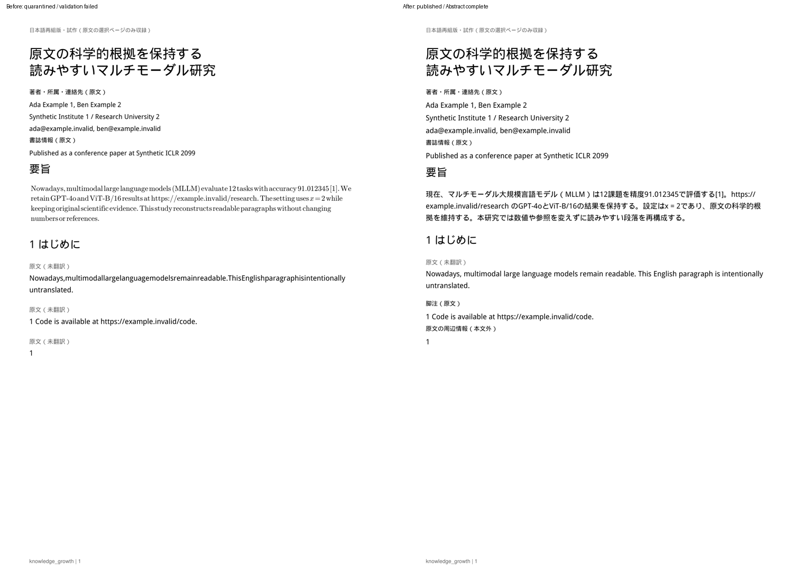
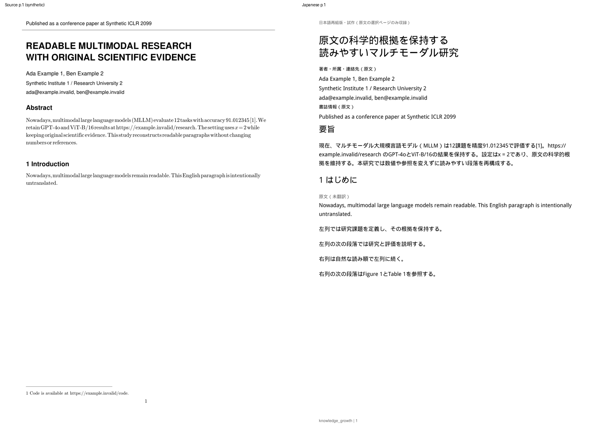
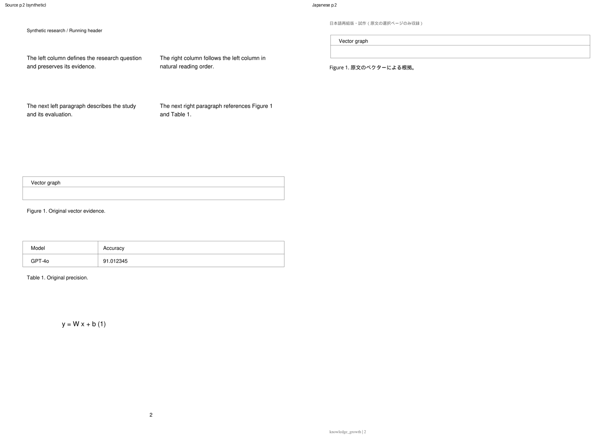
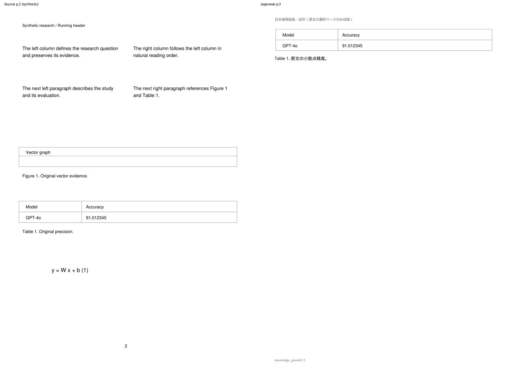
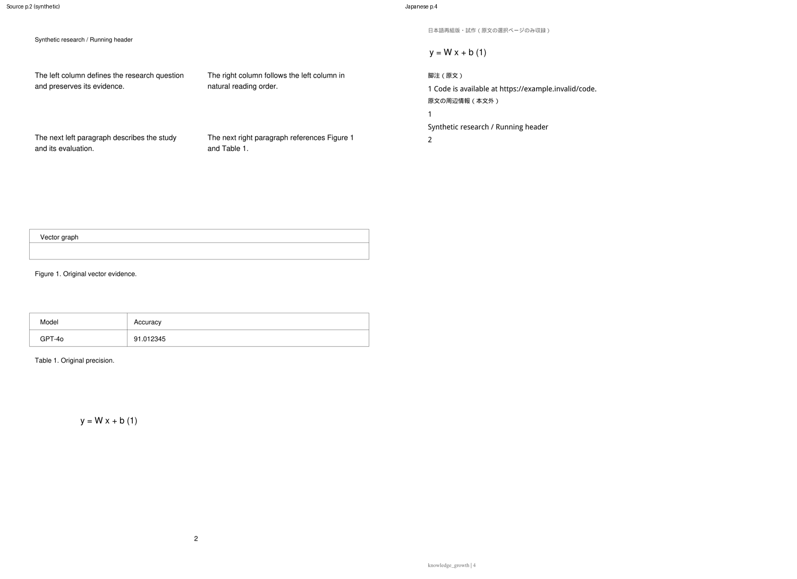
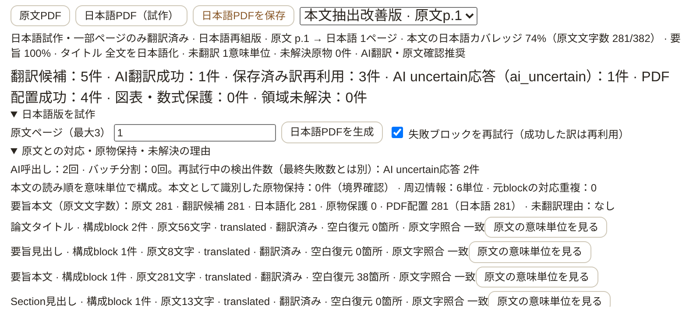

# 日本語PDF: 通常Abstract・英文空白・周辺情報の読書品質

T3-01 / T3-03の既存Draft PR #9を継続する修正。Windowsで生成・保存できたが、
Abstract本文の英語原物表示、連結した英文、孤立した1、周辺情報の小ささが残ったため、
本文検出・翻訳用抽出・組版を改善した。実MMAD原本はCloud/GitHubへ送信していない。
修正後のMMAD/Windows/実ChatGPTの品質は未検証である。

## 再現した原因と境界

`japanese_content.py`はMATH正規表現または数学フォントを一つ見つけるだけでblock全体を原物領域へ入れていた。
そこから交差するblockのbboxを繰り返し取り込み、ingestのfigure/table候補bboxも確定領域として使っていた。
通常Abstract内の短い`x = 2`やComputer Modern mathの1文字で全文が保護される合成ケースを再現した。
これはMMADの実際のPDF命令を確認した結果ではなく、報告症状を起こすコード経路の再現である。
ingestの短いEquation候補正規表現にも、`=`を含む普通の英文が合致する。
候補roleをDBで書き換えず、通常文の根拠がある場合は翻訳準備で再判定する。
実Equation候補と画像/描画交差は保護する。保護された短いAbstractも分母から消さない。

`ingest/pdf.py`と旧Semantic Assemblyはいずれもspanを空白なしで連結していた。
MuPDF自身も狭いword gapではspaceを補わず、CMR10・11pt・単語間1.3ptのPDFから
`Nowadays,multimodallargelanguagemodels`のような文字列が得られる。
旧DBを変更する再ingestは行わず、原PDFのglyph位置から翻訳用テキストだけを取得する。

ページ番号の旧分類は下端5%に限られ、p.1のy=785ptにある単独1を段落として翻訳していた。
本文と同じmarkerが付き、脚注も本文の途中へ流れていた。
周辺情報は10pt、専用原物ページの後には空ページを作ってから周辺情報を置く経路があった。

## 修正方式

- 実画像・drawing・table検出を使い、過去の巨大candidate bboxだけで通常本文を保護しない。
  空のcandidateを数学フォント検出・領域拡張に使わない。原文candidateのIDは保持する。
- 語数/長さにより通常proseと見出しを判別する。本文内の短い数式/数学fontだけで全文をFigureにしない。
  実際の画像/線/表との交差、単独Equation、曖昧な重なりは引き続き保護する。
  小さいascender/descender bboxの交差を、実際に重なった段落と区別する。
- 罫線はmargin内の孤立した水平線だけを装飾と認定する。表のgrid、画像/Caption近傍、本文を横切る線は除外しない。
  装飾候補に元blockがある場合も、そのID/座標をreportへ残し、Figureを捏造しない。
- 無罫表は複数の数値cell、または近接する同じ列位置の複数行を保護する。
  モデル名＋数値1列の表も対象。本文の上付き数字をnumeric rowだけで表にしない。
- `japanese_extraction.py`でraw glyphのbbox、origin、baseline、行を使い、同じbaselineの物理的な隙間をspaceへ戻す。
  復元前後で空白以外の全文字が同じ順序に一致した場合だけ採用する。未知の文字を補わない。
  上付き・アクセントをword gapにせず、連続glyphのモデル/数値/URLを分断しない。
  既存の行末ハイフン復元を継続し、通常のZero-shotや未知のcompoundは保持する。
- 本文内の短い式とURLの変更を`inline_math_changed` / `urls_changed`で拒否する。
  MLLM、数値・小数精度・引用・モデル・参照番号の保護を継続する。promptは`japanese-pdf-0.4`。
- 単独の中央下部数字をfolioとして区別し、隣接した式/脚注/所属番号を混同しない。
  下部の小さい脚注本文と別blockの上付きmarkを対応付け、原文脚注欄で保持する。
  header/footer/folioは周辺情報欄に置き、原文（未翻訳）markerを付けない。
- 本文・未翻訳英文・著者/所属/書誌/脚注は11pt。段落の先頭/末尾が孤立する場合は改ページ位置を調整する。
  native専用ページの後が空なら、その前ページの余白をtext-only end matterに再利用する。
  図表の原寸保持とCaptionの同ページ配置は継続する。
- Storyが作る標準的なff/fi/fl等の合字だけを本文文字照合で同値とする。
  一般的なNFKCによる数字・数学記号の正規化は行わない。科学的原物のglyph検査も変更しない。
- PDF.jsの選択範囲とStoryのglyph bboxの差には、日本語のtext単位の特定に限って配置fontの30%（2〜5pt）の余裕を使う。
  一意に確定しない複数単位は未解決のまま。実原文bbox/SourceAnchorを拡張・保存しない。

Figure/Table/Equationの`native-3`検査コード、pixel差しきい値0.2、font/glyph/path/image検査は変更していない。
実描画が本文と交差するケースは原物保持になり、font/clipを証明できなければ公開を拒否する。
本文を保護したままAbstractの分母から消して100%と表示しない。

## 保存と品質ゲート

追加migrationなし。schema v5、既存translations、生成jobのreport_jsonを再利用する。
layoutは`reflow-3`、assemblyは`semantic-1`、抽出は`glyph-spacing-1`。
同じ意味単位・同じテキストの成功訳は再利用し、空白が直ったテキストは別S/hashになる。
旧訳は削除しない。構成blockのユーザー編集と、空白だけが異なる旧groupのユーザー編集を検出したら、
AIで置換せず`assembled_user_edit_review`で原文全体を表示する。
document_blocks、source version/hash、SourceAnchorと既存ユーザーデータは変更しない。
旧PDFは表示/download可能だが、新しい生成cacheには使わない。

coverage.abstract（body/captionにも同じ指標）に以下を保存する。文字数は空白を除く元文字数。

| field | 意味 |
|---|---|
| source_chars | 原文全文字数。原物保持したAbstract本文も含む |
| candidate_source_chars | 実際の翻訳候補に入った原文文字数 |
| translated_source_chars | AI検証成功/再利用済みの訳が対応する原文文字数 |
| protected_source_chars | 図表等と交差して原物にした本文文字数 |
| placed_source_chars | PDF全体の配置・品質検証に通った元文字数 |
| placed_translated_source_chars | そのうち日本語配置が成功した元文字数 |
| untranslated_reasons | 安全なコードごとの未翻訳元文字数 |

`reading_quality.abstract`はcomplete / incomplete / not_selectedを区別する。
PDF生成できてもAbstractが未翻訳/原物保持ならcompleteにしない。
UIは「PDF生成済み／要旨の日本語化は未完了」と表示し、折りたたみ内へ各文字数を表示する。
各semantic unitにはrole、元ID、文字数、space復元件数、glyph文字一致、math font件数、保護理由コードを追加した。
通常/診断ログやreportに本文・訳・raw AI・認証情報・font名は出さない。

## 合成fixtureと比較

2ページの架空論文を生成する。学会header/罫線、長い2行タイトル、著者/所属、密なAbstract、
CMR10/CMMI10と複数span、MLLM、12課題、精度91.012345、引用[1]、URL、x = 2、
2段組Introduction、意図的な未翻訳英文、脚注/folio、Figure/Table/Equationを含む。
Cloudでは実Computer Modern fontを使用した。font binary/PDFはGitへ追加しない。
CMがないWindows/minimal CIでは生成fixtureだけTimes serifに代替し、CMがある環境で実fontのケースを検証する。

| 項目 | bf03dc5での合成再現 | 修正後 |
|---|---|---|
| Abstract | 281文字をvisual保護、候補0 | 候補281、翻訳281、保護0、配置281 |
| Abstract翻訳を失敗させた場合 | cropへの依存 | 11ptの英文、候補281/翻訳0、ai_uncertain、未完了表示 |
| 英文 | word gapが消失 | 物理距離からspace復元、識別子/数値/URL不変 |
| 脚注/folio | 通常段落・未翻訳marker | 脚注/周辺情報、実ID保持 |
| p.1だけの生成 | 原物検証で拒否 | 日本語1ページ、footerだけの2ページ目なし |
| 全2原文ページの本文 | Abstractが翻訳対象外 | 603文字中502文字、83.3%（未翻訳101文字は意図的） |
| Caption | — | 56/56文字、100%、原物と同じページ |
| 科学的原物 | 既存の厳密検査 | 3assetともvector/content成功 |

修正前は`visual_font_validation_unavailable`で公開拒否された。
比較の左側はその公開前の隔離PDFをrenderしたもの。旧実装の成功成果物とは主張しない。
修正後の英日4ページを200dpiでrenderし、全文タイトル/Abstract、空白/脚注、読み順、数値/線/数式/Captionを目視した。
両原文ページを選ぶと科学的原物の専用ページのため日本語4ページになる。

[修正後browser report](assets/japanese-pdf/reading-browser-report.json) / [旧HEADの安全な分類結果](assets/japanese-pdf/reading-before-summary.json)。

## 検証手順と結果

baseline: 全511件成功。新規20ケースは通常/失敗Abstract、4種類の狭いword gap、数学/URL/数値改変拒否、
巨大candidate、実罫線との交差、旧groupユーザー編集、無罫表1数値列、孤立末尾行、脚注mark/式/folioの区別を検証する。
通常の日本語がURLに直結する場合と、式の後の英語periodが句点へ変わる場合も誤拒否しない。
短いAbstractの保護文字数を落とさず、英語の保存済みユーザー編集を日本語化成功と誤集計しない。

最終の全pytestは **531 passed**（既存511＋追加20、216.68秒）。既存Starlette/httpx非推奨通知1件。
新Reader browserは **10項目**、既存semantic11、再組版17、翻訳診断8、原物8、Reader20、
Import/Brief34、Structured Brief17、合計125項目が成功した。Phase 1のQ&A/Highlight保存・reload・
PDF選択・SourceAnchor fallbackも成功し、各suiteのpageerrorは0。
数値/細線/画像/clip/glyph/fontの故意の破損検出を維持し、追加の一般的な条件緩和は行っていない。
実行: `.venv/bin/python -m pytest tests/ -q`。
新browser: `.venv/bin/python scripts/smoke_japanese_reading_browser.py --output /tmp/kg-reading-browser`。
既存のsemantic/reflow/translation/visual、Reader、Import/Brief、Structured Brief、Phase 1 Q&A/Highlight smokeも実行する。

## Windows / MMAD 第1ページ

1. アプリを終了し、`git fetch origin` → `git switch feat/japanese-pdf-prototype`
   → `git pull --ff-only origin feat/japanese-pdf-prototype`。`git rev-parse HEAD`をPRと照合する。
2. `start_knowledge_growth.bat`で起動し、Codex app-server / ChatGPT planへ接続する。API key不要、追加migrationなし。
3. MMADの「日本語版を試作」で原文ページ`1`を指定し、生成する。履歴の「本文抽出改善版」と新しいAbstract文字数欄を確認する。
4. タイトル全文、Abstract本文の日本語・順番、Introduction見出し、英文fallbackのspaceを確認する。
5. reportの「要旨本文（原文文字数）」で原文/候補/日本語化/保護/PDF配置を比較する。
   原物保護が残る場合はrole、保護判定コード、文字数、safe errorだけを報告する。
6. 未翻訳なら「失敗ブロックを再試行」を指定する。成功訳は再利用するが、空白が変わった意味単位は新しい全文訳が必要。
7. 著者/所属/書誌の11pt、脚注/folioの分離、孤立した未翻訳1や不要な末尾ページがないか確認する。
8. 日本語選択→原文を見る、Evidence、検索、図表/数値/数式、保存→外部viewer、再起動復元と既存データを確認する。
9. 第1ページの読書品質が合格してから2段組本文と評価表のページへ進む。Draftのmerge判断はこの実機結果で行う。

MMAD本文/PDF/画像、翻訳、raw応答、認証情報をCloud/GitHubへ送信しない。

## 変更ファイル・制約

主変更: app/japanese_extraction.py、japanese_content.py、japanese_semantics.py、japanese_pdf.py、
japanese_translation.py、routes_japanese_pdf.py、client/js/components/japanesepdf.js、pdfalignment.js、
prompts/japanese_pdf_v0_4.md。新fixture/tests/browser、既存version assertion、API/設計記録と比較PNG/数値JSONを更新する。

その他の変更ファイル:

- tests/fixtures/japanese_reading_factory.py、tests/test_japanese_reading.py
- tests/test_japanese_pdf.py、tests/test_japanese_semantics.py（layout version assertion）
- scripts/smoke_japanese_reading_browser.py、scripts/smoke_japanese_pdf_browser.py（layout version assertion）
- docs/architecture/api_spec.md、docs/redesign/v0.4/README.md、japanese_pdf_prototype.md、本記録
- assets/japanese-pdf/reading-before-after.png、reading-comparison-1〜4.png、reading-diagnostics.png
- assets/japanese-pdf/reading-browser-report.json、reading-before-summary.json

app/ingest/pdf.py、japanese_visual_quality.py、既存migrationは変更していない。

語間は物理的なgapが根拠で、根拠のない分かち書きは復元しない。複雑なMath font/clip/描画と本文の交差は原物保持/公開拒否が残る。
Abstractの位置/役割推定は任意の論文で完全ではない。短い式の検証は高度な数式parserではない。
専用図表ページの大きな余白は残る。全文翻訳、OCR/VLM、原物の自動縮小・高度な詰合せ、全文の意味同期は今回対象外。
原文最大3ページ/160領域/64出力ページ、既存retry/time limitを維持する。
