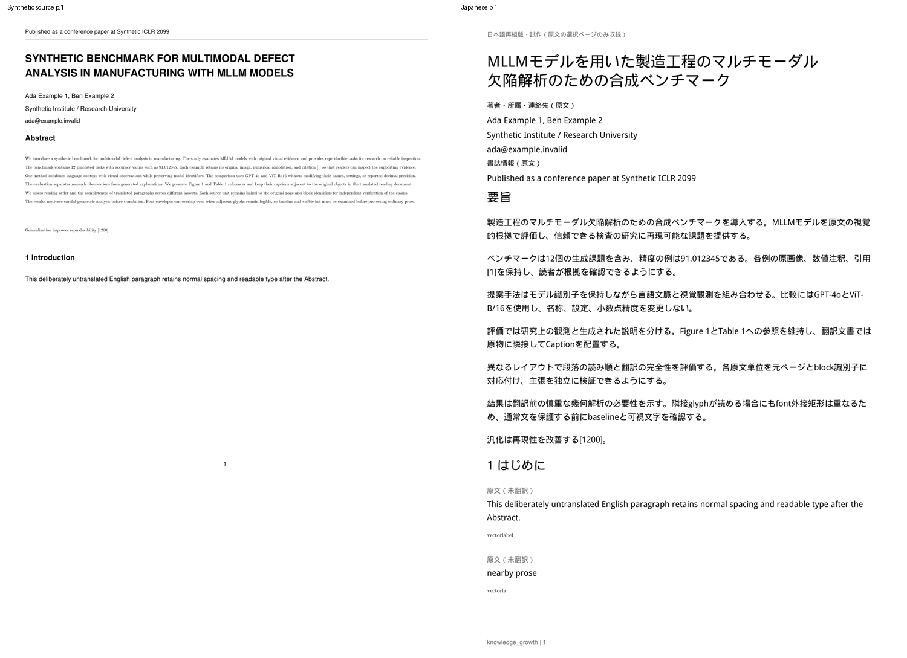

# 日本語PDF: 保護領域の余白による境界未解決の分離

Draft PR #9、T3-01 / T3-03の追加修正。起点HEADは
`5256ddce29fbdd116685c3b84f2ebdbfef973998`。
WindowsのMMAD p.1でfont外接矩形のみの交差5組が安全と証明された後、
`visual_text_boundary_unresolved`でAI呼出し前に停止した報告への対応である。

**MMAD原本・本文・画像はCloud/GitHubへ送信していない。修正後のMMAD/Windows/実ChatGPTは未検証。**
報告済みの5件にはseed/三値判定の情報がないため、実MMADでどのseedに属するか、
TrueとNoneの内訳が何件かはまだ確定できない。今回の数値診断でローカル確認できる。

## 再現した具体的な条件

原文3ページの生成fixtureを作った。p.1は既存の1,150文字Abstract、
p.2は5つの小さなnative描画・識別子labelと、その直下の通常英文、
p.3はFigure/Table/Equation・Caption・2段組本文である。
CMR glyphプログラムを変更せず、font descriptorで行bboxを広げ、
p.2のbaseline差を7.782ptにした。

旧HEAD全体を別ディレクトリへ`git archive`で展開し、今回のfixtureだけをコピーして、
実APIの登録→生成を実行した。次をすべてassertし、公開失敗とAI呼出し0を再現した。

| p.2の組 | glyph数 | baseline最小差 | ink交差 | 原描画照合 |
|---|---|---:|---:|---|
| 1 | 11 / 11 | 7.782pt | 0 | 一致 |
| 2 | 8 / 11 | 7.782pt | 0 | 一致 |
| 3 | 41 / 20 | 7.782pt | 0 | 一致 |
| 4 | 41 / 27 | 7.782pt | 0 | 一致 |
| 5 | 16 / 27 | 7.782pt | 0 | 一致 |

5組すべて`font_envelopes_only`、境界未解決5件、
`failed / visual_text_boundary_unresolved / content_detection`になった。
実MMADの描画命令を調査・再現したという意味ではなく、報告された数値と失敗経路を再現したもの。
[旧HEADの数値結果](assets/japanese-pdf/boundary-before-report.json)を保存した。

旧処理はpositive seedを種に、直接触れるlabelを保護メンバーへ入れ、
メンバーの全文bboxにさらに2ptの余白を付けてcropを拡大する。
この余白が、文字同士は衝突していない次行のinkを拾う。
`touches()`のTrueは「指定されたcrop内に文字のinkがある」という意味であり、
元の図形・数式のinkと文字が物理的に衝突したことの証明ではない。
Noneはmask/font/glyph等を検証できない状態だが、旧境界記録ではTrueと区別できなかった。

## 修正方式と安全性

`japanese_boundaries.py`へseed/保護group/余白の分離を切り出した。

- positive seedを、drawing / image / detected_table / numeric_table /
  equation / isolated_math_or_special_fontとして保持する。
  seed ID、object index、必要ならowner block ID、保持必須矩形、表示用矩形を記録する。
  provenanceを矩形unionで失わない。groupの合流は共通メンバーまたは元seed同士の接触に限り、
  合流後の大きな外接矩形だけで別seedをつながない。
- drawingとTableの既存2pt安全余白は保持必須とする。
  画像は画像bbox、式/特殊fontは元blockの全文bboxを必須とする。
  メンバー全文bboxは、ingestの小数点以下3桁への丸めを囲む0.001ptを加えて完全に含める。
  glyphの可視部分だけに切り詰めない。元のSourceAnchor/bboxは変更しない。
- `InkProof.contact()`はTrue / False / Noneを維持し、
  `ink_contact` / `bbox_only` / `bbox_separated` / `contact_unproven`と固定proof errorを返す。
  seedへの接触と、拡大cropへの接触を別々に記録する。
  Noneは保守的に保持し、実際のink接触と報告しない。
- 拡大cropで境界に問題があれば、**全seedの必須領域と全メンバーの全文bboxのunion**を候補にする。
  これは元内容を削る操作ではなく、追加余白を外す操作である。
  すべての非メンバーに対して、縮小後の接触がFalseと証明できた場合だけ採用する。
  TrueまたはNoneが1件でも残れば採用しない。
- `boundary_checks`へgroup/seed/元blockのID、縮小前と必須cropの分類・ink数・proof error、
  解決結果`padding_trimmed`または`unresolved`を記録する。
  最終的な`boundary_conflicts`チェックは残す。4領域を分離できても、残り1領域を証明できなければ公開拒否する。
  未解決部分を落としたPDFや、本文を重複させた原ページを成功扱いしない。
- 分離後も既存native-3でfont/glyph/path/image/数値/画質を検証する。
  科学的内容の検査コード・pixelしきい値0.2・native crop実装は変更していない。
  科学的図形と実際に交差する文字は翻訳せず原物に残す。
  crop内で無関係なinkを分離できないケースや検証不能なケースはAI前に拒否する。

GUIの折りたたみreportでseedと前後の接触分類・分離結果を確認できる。
原文・訳・画像・raw AI応答・font名/プログラム・認証情報はreport/通常ログへ出さない。
本文PDFへ診断注記を追加しない。

schema v5、既存translations、job report_jsonを継続。**追加migrationなし。**
layoutは`reflow-5`、重なり/境界診断は`glyph-ink-2`。
旧PDFは削除せず利用できるが、新規生成cacheには使わない。
Semantic Assembly、original_block_ids、SourceAnchor、ユーザー編集/成功訳の保護、
タイトル意味review、Codex app-server + ChatGPT plan、11pt組版、Caption同ページ、
atomic保存・再起動復元・Brief/Note/Highlight/Q&Aの契約は変更していない。

## 修正前後の数値

| 指標 | 旧HEAD | 修正後 |
|---|---:|---:|
| p.2 font_envelopes_only | 5組 | 5組 |
| ink接触とみなされていた境界 | 5件 | 5件を余白縮小で分離 |
| 最終境界未解決 | 5件 | 0件 |
| 5つのcrop高さ | 13.000pt | 9.002pt |
| 図形/全文字bbox | 元のまま | すべて保持 |
| AI呼出し | 0 | 25（fake・意図的未翻訳のbounded retry含む） |
| PDF公開 | 失敗 | preview_ready・5ページ |

修正後のAbstract: **原文1,150 / 候補1,150 / 原物保護0 / 日本語化1,150 /
PDF配置1,150・うち日本語1,150**。文字数は空白を除いた対応原文文字数。
旧jobの候補/日本語/配置0は内容検出で停止したためであり、Abstract自身の誤保護ではない。

5つの非メンバー英文は通常textの翻訳候補として残る。fakeでは意図的に未翻訳にし、
空白を保持した11pt英文で再組版した。小さい元labelは図形の一部としてそのまま保持する。
全本文は1,563文字/日本語化1,371文字（87.72%）、未翻訳192文字。
Caption56/56。5つの小原物とFigure/Table/Equationの計8assetがnative-3を通過。
Figure/Table/Equation3assetの平均pixel差0、他5assetは0〜0.002107で、
全8assetともfont/glyph/path/image/vectorの検査に成功した。
欠落/重複/原文ID重複/用紙外/重なり0、元PDF hash/blocks/versionは不変。
再生成では16成功訳を再利用した。

生成全5ページを200dpiでrenderし目視確認した。
原寸の図表を専用ページへ置くため、図表ページの余白は引き続き多い。
全文翻訳・高度な図表の詰合せ・VLM/OCRは今回の対象外。



[通常英文の再組版](assets/japanese-pdf/boundary-comparison-2.png) /
[Figure](assets/japanese-pdf/boundary-comparison-3.png) /
[Table](assets/japanese-pdf/boundary-comparison-4.png) /
[Equation](assets/japanese-pdf/boundary-comparison-5.png) /
[seedと分離の診断](assets/japanese-pdf/boundary-diagnostics.png) /
[実inkを分離できない拒否ケース](assets/japanese-pdf/boundary-rejected.png) /
[検証report](assets/japanese-pdf/boundary-browser-report.json)。
生成PDF/DB/font binaryはGitへ追加せず、PNG/安全なJSONだけを保存する。

## テスト

- baseline全pytest **557 passed**。修正後全pytest **566 passed**、271.71秒、
  既存Starlette/httpx非推奨通知1件。追加9件。
  最終fixtureの追加9件も18.14秒で全成功。
- 5件分離、実inkが必須cropに残る拒否、Noneの区別/拒否、1件未解決なら公開しないこと、
  既存AI成功訳/ユーザー編集を内容検出失敗でも更新しないこと、図形との実交差を翻訳しないこと、
  1,150文字の順序/11pt/選択可能text、原文hash/blocks、保存/再起動、ローカルread-only診断を検証。
- Chromium: 新boundary **7**、既存overlap6 / reading10 / semantic11 / reflow17 /
  翻訳診断8 / 原物9 / Reader20 / Import・Brief34 / Structured Brief17 / runtime12、
  計**151項目成功、全suiteのpageerror 0**。
  Phase 1のQ&A、Highlight保存/reload、SourceAnchor fallbackも別途成功。
- 既存native-3のglyph/font/path/image、細線、表数値精度、clip、Caption破損検出は全て維持。
  原物browserでも実破損3assetを全件拒否し、失敗PDFが404になることを確認。

```bash
.venv/bin/python -m pytest tests/ -q
.venv/bin/python scripts/smoke_japanese_boundary_browser.py --output /tmp/kg-boundary-browser
```

## Windowsでの再検証

1. アプリを終了して既存branchを更新する。

   ```powershell
   git fetch origin
   git switch feat/japanese-pdf-prototype
   git pull --ff-only origin feat/japanese-pdf-prototype
   git rev-parse HEAD
   ```

2. `start_knowledge_growth.bat`で起動しChatGPT planへ接続。
   MMADの原文ページ`1`を生成する。履歴が**境界分離検証版**であることを確認。
   既存の正常訳は再利用し、必要なら「失敗ブロックを再試行」を使う。
3. 折りたたみreportをスクロールし、5件それぞれのgroup/seed/元blockと、
   `追加余白を縮小・分離済み`または`境界未解決`を確認する。
   seed種類/object index/保持必須矩形を照合する。
   None相当は`局所検証不能`、Trueは`ink接触`、Falseは`矩形のみ接触・inkなし`等と分かれて表示される。
4. Abstract原文1,150に対する候補/保護/日本語化/配置の文字数を確認する。
   生成できたらタイトル/本文順序/11pt/欠落・重複/図表・数式・Caption/原文ジャンプ、
   保存・外部viewer・再起動復元を確認。p.1合格後に本文・評価表ページへ進む。

まだ止まる場合は、URLの`/#/read/<source_id>`を使って既存のローカル診断を実行できる。

```powershell
.venv\Scripts\python.exe scripts\diagnose_japanese_overlap.py --source-id "<source_id>" --pages 1 |
  Out-File -Encoding utf8 overlap-local.json
```

同じ`KG_DATA_DIR`を使う。スクリプト自体の変更は不要で、新reportをそのまま出力する。
既存DBはmode=ro、PDFはメモリ読み込みのみ。AI/ネットワーク/DB更新/画像出力なし。
`pages[].seeds`と`seed_contacts`、`boundary_checks`、`boundary_conflicts`を確認すれば、
どのseedの必須範囲でink/証明不能が残ったかを数値と固定コードで特定できる。
本文/PDF/画像/訳/raw応答/認証情報はCloudへ送信しない。

## 変更ファイル

- `app/japanese_content.py`: seed収集、境界plannerの呼出し。古い矩形merge処理を除去。
- `app/japanese_boundaries.py`: seed provenance、必須/任意範囲、局所分離、診断。
- `app/japanese_overlap.py`: 3値contactのsafe分類、glyph-ink-2。
- `app/japanese_pdf.py`: reflow-5によるcache区別のみ。
- `client/js/components/japanesepdf.js`: seed/境界診断と履歴ラベル。
- `tests/fixtures/japanese_boundary_factory.py`, `tests/test_japanese_boundaries.py`: 再現/安全性/保存テスト。
- `scripts/smoke_japanese_boundary_browser.py`: Reader受入テスト。
- 既存PDF/semantic/overlap testsとreflow browserのversion期待値。
- 本記録、README/試作概要、PNG/JSON証拠。

一部が安全に分離できても、残りの科学的原物を証明できなければ公開は止める。
図表/式の内容を落とすこと、未証明をFalseへ変えること、native-3のしきい値緩和は行わない。
実MMADの5件のseed内訳と修正後品質は、上記のWindows診断・生成で確認する。
