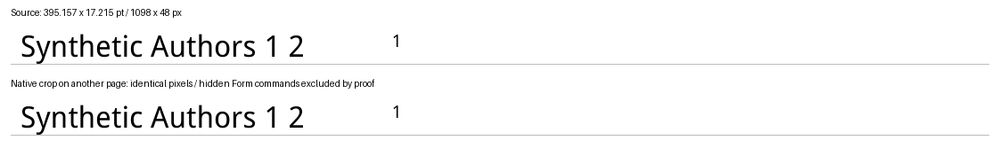
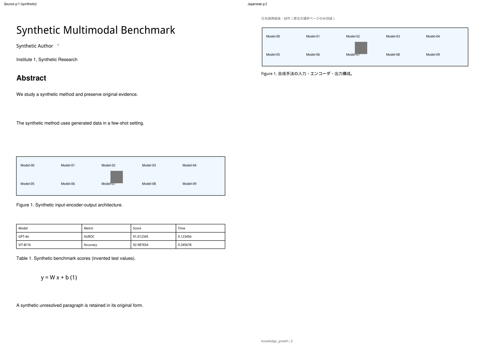
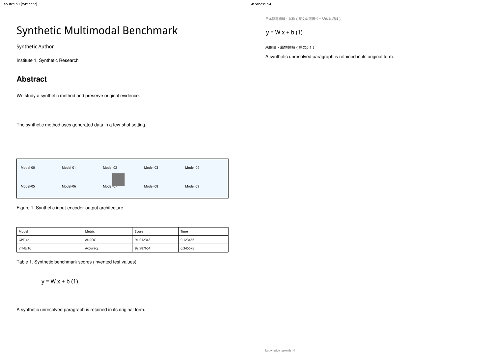
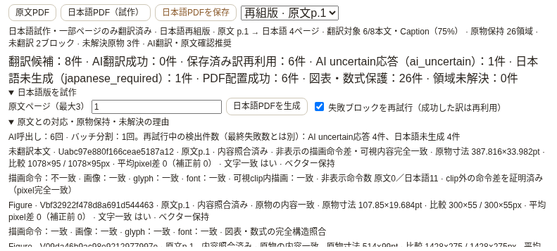

# 日本語PDF: original_textの不可視Form命令とclip検証

Draft PR #9、T3-01 / T3-03追加修正。schema v5 / reflow-1を維持。
Windowsの報告は候補8・保存済み訳6・ai_uncertain1・japanese_required1・保護26、
original_text 1件だけがpixel差0・文字一致・ベクター保持のままdrawing_or_image_changedで失敗した。
MMAD原本はCloudへ送信していない。この修正後のWindows/MMAD/実ChatGPTは未検証。

## 原因と合成再現

旧HEAD `4296ff5310474ff7cd942d10f9fba8fcd210af41`の`paths()`は、
`get_drawings()`のpath全体のbboxが検査領域と交差すれば比較対象へ入れる。
このAPIはForm XObjectのclip外にある非表示のpaint命令も返す。
`show_pdf_page()`で元ページを複数cropとして配置すると、各Formに原ページのpath資源が残る。
別の原物cropの大きなpathが検査中のcropまで延びていても、そのFormのclipが表示を遮っている。
旧比較ではこの遮蔽を考慮しないため、見えていない線まで「追加された線」と判断した。

大きな英語タイトル、著者・番号・上付き、境界を横切る0.1pt線、領域を囲む大きな枠を生成した。
著者の原文領域を別ページへ移し、同じ原ページのタイトルcropを近くに配置すると再現する。
同じPDFについて旧`inspect_visual()`と新判定を実行した。

| 診断 | 旧HEAD | 修正後 |
|---|---|---|
| 領域 | 395.157 × 17.215pt | 同じ |
| 200dpi比較 | 両者1098 × 48px | 同じ |
| 平均pixel差 / 補正前 | 0 / 0 | 0 / 0 |
| 文字 / glyph / font / 画像 | 一致 | 一致 |
| 全path数 | 原文2、日本語4 | 同じ・構造不一致は記録する |
| 非表示path | 判別しない | 日本語側2件をclipの非交差から証明 |
| 可視pathと実効clip | 判別しない | 一致 |
| 結果 | failed / drawing_or_image_changed | passed / nonvisible_drawing_commands |

これはWindowsの数値症状を再現する合成原因であり、MMADの具体的なpath命令を確認した結果ではない。
新reportのdrawings_preserved / images_preservedを実機で確認する。



## 検証ポリシー

`get_drawings(extended=True)`のlevelを使ってclip scopeを追跡する。
原物領域、ページ境界、各scopeのscissorを交差させ、実効clipが空なら、そのscope内のpathは
この領域へ絶対に描画できないと証明できる。曲線clipでもscissorは外接範囲なので、非交差の証明には使える。

実効clipと領域が交差する場合、矩形clipだけを検証対象とする。
可視の非矩形clipやtransparency groupを矩形と仮定せず、検証不能として拒否する。
可視候補のpathは全座標・線幅・cap/join・dash・色・opacity・fillを残し、実効clipも比較する。
候補範囲にはMuPDFのpaint bboxも含め、capやmiterが線の中心座標からはみ出す場合も検査する。
境界を横切る線を短縮したり、線の中心が領域外という理由で除外したりしない。
画素平均が小さくても、clipが変わって可視の細線が欠落すれば拒否する。

| 対象 | 成功条件 |
|---|---|
| original_text、全path構造一致 | 可視path/clip、文字/glyph/font、原寸、混入/欠落、画像資源が一致し、既存pixel基準を満たす |
| original_text、全path構造不一致 | 上記の全内容検証に加え、可視path/clip一致の証明と**200dpi RGB完全一致（平均差0）**が必要。不可視命令だけの差と判定する |
| Figure/Table/Equation | 全path構造、可視path/clip、文字/数値/glyph/font、画像資源の厳密照合を継続。不可視命令差の例外は適用しない |
| 画像、全kind | 元のpixel digest・寸法・位置を完全照合。画像の非表示部分の差を免除しない |

**pixel差0.2のしきい値は変更しない。** 構造比較や画像検査を削除しない。
original_textの例外はpixel完全一致とclipの構造証明を両方必要とする。
フォント・glyph・文字・画像が変わればpixel差が小さくても拒否する。
全pathの一部だけを書き換えて「可視形状が同じ」とみなすような一般的な幾何正規化は行わない。

## 安全な診断と保存

drawings_preservedとimages_preservedをUIへ別々に表示する。
エラー分類もdrawing_changed / image_changed / drawing_and_image_changedに分ける。
全構造不一致で成功したoriginal_textはnonvisible_drawing_commandsと表示する。
可視clip検証の可否・一致、不可視命令数、exact_pixels_preserved、
nonvisible_drawing_difference_provenを数値/booleanで記録する。
既存のkind/page/寸法/pixel差/文字・glyph・font/vector情報も維持する。
原文・訳・path座標・画像・font名・digest・AI raw response・認証情報は診断や通常ログに出さない。

quality versionは`native-3`。既存report_jsonを拡張し、migrationは追加しない。
native-2以前の成果物は削除せず再表示/download可能だが、新生成cacheへは返さない。
保存済み成功訳6件、失敗IDだけの再試行、ユーザー編集、11pt再組版、原文block対応・SourceAnchor、
atomic保存・再起動復元は既存契約を維持する。

## 検証結果

baseline全pytest **480 passed**。今回追加した17ケースは、不可視Form再現、原寸・hash、
科学的原物への免除禁止、文字/glyph/font/細線/画像改変、pixel完全一致必須、非矩形clip拒否、
境界stroke、原文/図/表/式のclip変更による細線欠落、失敗後の6訳再利用を検証する。
既存31原物テストの小数精度・細線削除・画像1階調改変・注釈1pixel改変も維持する。

旧HEADを使ったbrowser再現では、8候補・6成功・2未翻訳・26保護の合成論文で
original_text 1件だけが失敗し、修正後は6訳を再利用して日本語4ページを公開できる。
未翻訳2件を一度ずつ保持し、表の小数検索、保存/reload、原物診断を確認する。
Figure2/Table1/Equation1へ線を追加した破損fixtureは全件拒否し、PDF取得404・6訳保存を維持する。

全pytest **497 passed**（追加17件、既存Starlette/httpx非推奨通知1件）。
原物browser **10項目**、翻訳診断8、再組版17、Reader20、Import/Brief34、Structured Brief17が成功。
Phase 1のQ&A、Highlight保存/reload、PDF選択、SourceAnchor fallbackも成功。各suiteのpageerrorは0。
200dpiのcrop比較と英日4ページ画像を目視し、文字・上付き・境界線、11pt本文、
図表/Caption隣接、表のモデル名/小数/罫線、数式、原文fallbackが保たれていることを確認した。







[tiny clipの修正前後の数値](assets/japanese-pdf/clip-tiny-report.json)・
[旧HEAD/修正後/実破損/retryのbrowser結果](assets/japanese-pdf/clip-browser-report.json)。

```bash
.venv/bin/python -m pytest tests/ -q
.venv/bin/python scripts/smoke_japanese_visual_browser.py --baseline-ref 4296ff5310474ff7cd942d10f9fba8fcd210af41 --clip-repro --output /tmp/kg-clip-release
```

生成PDFは一時ディレクトリのみへ保存し、PDF/font binaryはGitへ追加しない。

## WindowsでMMAD p.1を再検証

1. アプリを終了し、repositoryで次を実行する。

   ```powershell
   git fetch origin
   git switch feat/japanese-pdf-prototype
   git pull --ff-only origin feat/japanese-pdf-prototype
   git rev-parse HEAD
   ```

2. HEADをPRの最新commitと照合し、`start_knowledge_growth.bat`で起動する。schema v5の追加移行はない。
3. Codex / ChatGPT planを接続し、登録済みMMADのReaderで「日本語版を試作」を開く。
   原文ページ`1`と「失敗ブロックを再試行（成功した訳は再利用）」を指定し生成する。
4. 保存済み成功訳6件の再利用を確認する。ai_uncertain / japanese_requiredが残っても、
   原文fallbackの品質とは別の診断として確認する。
5. 「原文との対応・原物保持・未解決の理由」で当該original_textを確認する。
   描画命令と画像の各一致結果、可視clip検証、不可視命令数、pixel差、glyph/font/vector保持を見る。
   この原因なら「非表示の描画命令差・可視内容完全一致」と表示される。
6. 日本語本文と未翻訳本文、著者・上付き、図表の数値/モデル/線、数式、Captionを原文と照合する。
   原文を見る/Evidence、zoom・位置、選択/検索、保存、外部viewer、再起動後の復元も確認する。
7. 失敗が残る場合はsafe code・asset kind/page・寸法・pixel差・drawings/images・可視clip/glyph/font一致を報告する。
   MMAD、原文/訳、画像、raw response、認証情報をCloud/GitHubへ送信しない。

Draftを維持する。実Windowsでの成功は主張せず、実機の結果でmergeを判断する。

## 変更ファイルと制約

主変更はapp/japanese_visual_quality.py、client/js/components/japanesepdf.js、
tests/test_japanese_clip_quality.py、tests/fixtures/japanese_visual_factory.py、
tests/test_japanese_visual_quality.py（version期待値）、scripts/smoke_japanese_visual_browser.py、
本書とREADME/API/既存品質記録、および合成画像・数値report。
翻訳prompt/runtime/DB/SourceAnchor/Reader切替の実装は変更しない。

非矩形の可視clip・transparency groupはこの限定的なclip証明では扱わず拒否する。
画像資源の不可視部分だけの差も免除しない。科学的原物は不可視path構造差でも従来どおり拒否する。
200dpi/1,600万pixel上限、最大3原文ページ、全文/OCR/VLM/左右比較未実装というPoCの制約は維持する。
