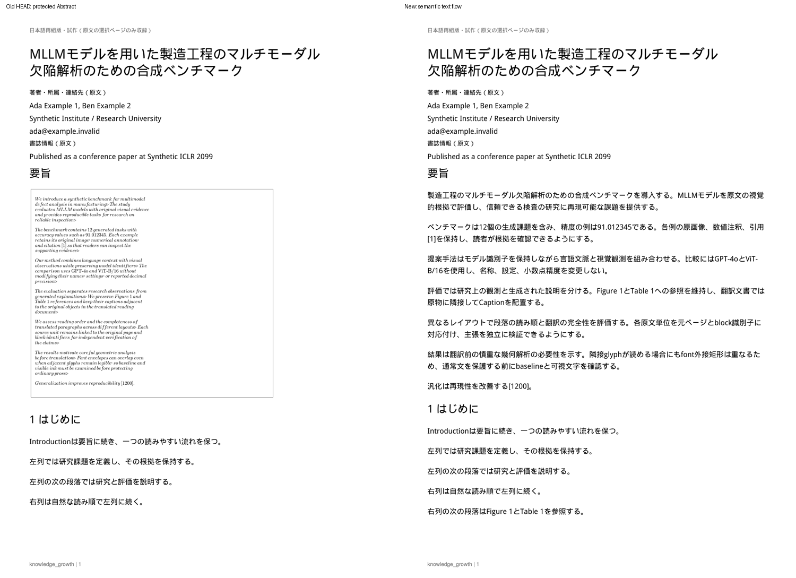

# 通常本文と科学的原物の経路分離（reflow-7）

Draft PR #9 / T3-01・T3-03の追加修正。Windowsで報告された本文64%・Abstract24%は修正前の実測であり、本稿の修正後の数値はすべて**合成PDFとfake runtime**の結果である。MMAD原本・本文・画像・訳はCloudへ送信していない。最新修正を実Windows／実ChatGPTで確認したとは主張しない。

## 根本原因と設計

従来は、本文の可読テキストへの復帰を「一定長の英文」「数学fontの割合」「font外接矩形の非交差」といった断片的条件に依存していた。密な行間・複数span・短い行では同じ段落の一部だけが復帰し、残りが科学的な原物と同じ経路へ入った。さらに、PyMuPDFの`Font.glyph_bbox()`は一部のTeX fontで**異なる文字にもfont全体と同じ矩形**を返す。これを実glyph輪郭として衝突判定に使うと、文字のinkは離れていても復帰を拒否する。合成fixtureのCMMIで異なる3glyphの矩形が同一になることを確認した。

新しい共通処理を3つの経路に分けた。Abstractだけの例外や、MMADの語句・座標に依存する条件は設けていない。

| 経路 | 必要な根拠 | 翻訳失敗時 | 品質検査 |
|---|---|---|---|
| 通常テキスト | 元span所属と文字順、Unicode/GID、原font program、origin/advance、可視描画属性、重なりがあればnative glyph inkの非衝突 | 空白・数値・引用・識別子を保った11pt英文 | 元block群の完全性、内容、配置・抽出・重なり |
| scientific_visual | 実画像・描画、罫線/数値列、数学的構文または数学gridなどの積極的根拠 | 原物をnative保持 | **既存native-3を変更せず**glyph/font/path/image・200dpi・clipを厳密照合 |
| unresolved_text | glyph所属、font、可視属性、実衝突等を安全に証明できない文章 | 原物保持／公開拒否、要確認 | 本文として未完了と数える。科学的Figureと混同しない |

`japanese_textflow.py`が本文のprovenanceと数学構造を担当し、`japanese_science.py`がpositive scientific objectsを作る。`japanese_content.py`は両者と既存boundary proofを組み合わせる。ingestの大きなfigure/table candidate bbox自体は科学的領域の根拠にしない。

元のnative span・glyphとの対応が確認できる場合、再組版する文章にnative cropの描画完全一致まで要求しない。ただし単なる文字抽出成功でも通さない。未知glyph、不可視／縦向き／不明な描画属性、曖昧な所属、実際の文字衝突は未解決となる。横方向のadvance変換は原traceから検証し、接触証明にはその変換と原fontによる実glyph maskを使う。maskは288dpi・1pixelの保守的拡張・面積／比較数の上限を維持し、取得不能を非交差と見なさない。

font外接矩形はclip/enclosureの保守的な包含検査にだけ使い、文字衝突の判定は実glyphのmaskを用いる。従来の`overlap_unproven`診断は原描画の完全再構成の可否を引き続き表すため、通常文章のprovenanceが確認済みでも残る場合がある。新しい`text_flow`と`scientific_relations`を合わせて確認する。

通常文を囲む単一の罫線矩形は、直前のSection/Abstract見出し、内部の全テキストprovenance、余白、画像・追加path・数式・Captionの不存在を確認できた場合だけ装飾として分離する。**見出しとの関係がない文章入りの箱は、図かもしれないため除外しない。** 数学fontの混在だけでは数式とせず、数式syntaxや複数行・複数列の数学atomの整列がある場合は原物保持する。等号のない3×3数学gridも全体を1つのEquationとして保持する。

## 原文対応・翻訳と状態

- 原`document_blocks`、SourceAnchor、source/version/hash、全`original_block_ids[]`は変更しない。検証済み行をbaseline・列・段落順でSemantic Assemblyへ渡す。
- **migrationなし、schema v5**。既存`translations`とjobの`report_json`を再利用する。新layoutは`reflow-7`、分類は`content-lanes-1`。古い生成物は保持し、新cacheとは区別する。
- 抽出・結合全文が変わればgroup hashが変わり、古い部分訳を誤適用しない。既存成功訳は再利用する。ユーザー編集rowはstatus・時刻も含め更新しない。以前の編集済み部分groupが新しい段落に含まれる場合も、上書きせず全体を編集確認対象にする。
- `ai_uncertain`はAIの申告、`japanese_required`はtranslated応答の日本語文字未生成として分ける。schema検証後の申告状態・入力文字数・出力文字数・日本語文字数・安全な検証codeだけを最大8試行分保持し、本文・訳・raw応答は診断に記録しない。
- 折りたたみレポートの**「この翻訳だけ再試行」**は失敗semantic IDだけを送る。`retry_failed:true`と`retry_unit_ids:[...]`は、同一source/version/hash・対象ページ・現layoutの直近jobでAI失敗したIDだけを許可する。成功ID・別ページ・未知ID・重複をAI呼出し前に拒否する。選択しなかった失敗は`retry_deferred`として保持する。
- 数値・小数精度・引用・モデル名・URL等の既存検証は変更しない。正常訳、ユーザー編集、未選択の失敗rowは保持し、再試行対象の検証だけを実行する。従来の有限batch・bounded retry・呼出し／時間上限を維持する。
- AI翻訳、PDF配置、原物品質、最終公開を別々に報告する。Tableの品質失敗をタイトルのAI失敗へ書き戻さない。公開失敗時の壊れたPDFは取得不可。

## Abstractの独立した読書品質ゲート

通常のPDF公開と独立した`reading_quality`を追加した。Abstractの原文文字数、候補、原物保護、科学的原物／未解決本文、日本語化、配置、日本語として配置、理由別未翻訳数を数える。文字数は原文の非空白文字数換算であり、訳文の長さではない。

選択内容にAbstractがある場合、その本文がすべて分類済み・日本語として配置され、原物として残る本文が0であることを必要条件とする。本文全体の翻訳カバレッジ・全文タイトル・品質検証・公開も別途確認する。部分成功PDFは保存可能だが**「読書品質未達」**と表示する。Abstractを含まない選択は`not_selected`と報告する。これは完全性の自動ゲートであり、翻訳の意味の正しさや実論文の読書品質は人が確認する。

## 合成PDFの修正前後

旧HEAD `2c25a5bda2e48afac609424507cdf2a24fb314d0`全体を別exportし、同一PDFを実APIで登録・生成した。1150文字の7段落が密な行間・複数spanにより31の本文blockへ分かれ、CMMI/CMR混在、baseline差7.782pt、横罫線、Section、近い通常文と別領域のFigure/Table/Equationを含む。font binaryや生成PDFはcommitしていない。

| Abstract・原文文字数換算 | 旧HEAD | 新・正常fake AI | 新・部分失敗fake AI |
|---|---:|---:|---:|
| 原文 | 1,150 | 1,150 | 1,150 |
| 翻訳候補 | 0 | 1,150 | 1,150 |
| 原物保護 | 1,150 | 0 | 0 |
| 日本語化 | 0 | 1,150 | 597 |
| PDF配置 | 1,150 | 1,150 | 1,150 |
| 日本語として配置 | 0 | 1,150 | 597 |
| 読書品質 | 未達 | 自動ゲート通過 | 未達 |

旧版も`preview_ready`になったがAbstractが英語cropだった。修正後は日本語を正しい順で1回ずつ抽出でき、本文全体も1426/1426文字を日本語配置した。部分失敗ケースは`ai_uncertain`2件367文字、`japanese_required`1件186文字を11pt英文で保持（本文873/1426、日本語Abstract597/1150）。3つの失敗IDをUIから個別再試行し、毎回AIへそのIDだけを渡して全1150文字へ到達した。Windowsの64%／24%を同じ数値で再現したという意味ではない。

Figure/Table/Equationの3assetはnative-3のglyph/font/drawing/image/clip検証成功、200dpi平均pixel差0。Captionを同じページに保持した。Tableの細線の故意改変は当該assetの品質失敗として公開拒否した。等号のない数学grid、実文字衝突、不可視文字、曖昧な文章入り図形、数字改変、過去のユーザー編集も別fixtureで検証した。



英日比較（200dpiでrenderした画像を並置）。生成日本語4ページ、部分失敗時の11pt英文、図表数式とCaptionを目視確認した。本文の欠け・重複・重なりは認めなかった。原物専用ページの大きな余白は残る。

- [原文と日本語本文](assets/japanese-pdf/lanes-comparison-1.png)
- [FigureとCaption](assets/japanese-pdf/lanes-comparison-2.png)
- [TableとCaption](assets/japanese-pdf/lanes-comparison-3.png)
- [Equationと本文外metadata](assets/japanese-pdf/lanes-comparison-4.png)
- [部分失敗の診断画面](assets/japanese-pdf/lanes-mixed-diagnostics.png) / [全再試行後](assets/japanese-pdf/lanes-complete-diagnostics.png)
- [本文を含まない数値結果・分類根拠・品質検査](assets/japanese-pdf/lanes-results.json)

## 回帰検証

- 変更前baseline **576 passed**。
- 全pytest **596 passed**（追加20件）。既存Starlette/httpx非推奨warning1件。
- Chromium **167項目成功、pageerrors 0**：追加lanes8、reflow17、reading10、semantic11、overlap6、boundary7、translation8、visual10、recovery7、Reader20、Import/Brief34、Structured Brief17、runtime12。
- Phase1のPDF選択・Highlight保存/reload・mock Q&A・SourceAnchor fallbackも別途成功。
- 新テストは原文bytes/hash・document_blocks/version・SourceAnchor、全original ID、本文抽出順序と重複0、11pt英文、保存済み訳row・ユーザー編集row不変、selected retry、ファイル取得・offline再表示・DB再openを確認。
- `japanese_visual_quality.py`を変更していない。既存のglyph/font/path/image、細線、小平均pixel差でも数値・画像改変を拒否するテスト、Caption、clip、native-3の厳密検査はすべて維持。
- Browser同時実行でoverlap harnessの既存5秒expectが時間切れになったため、他suiteと同じ30秒へ修正し単独で6項目成功。アプリの安全検査時間や閾値は変更していない。

再現コマンド：

```bash
python -m pytest tests/ -q
python scripts/smoke_japanese_lanes_browser.py --output /tmp/kg-lanes-browser
```

## WindowsのMMAD p.1再確認

1. アプリを終了し、repositoryで次を実行する。

   ```powershell
   git fetch origin
   git switch feat/japanese-pdf-prototype
   git pull --ff-only origin feat/japanese-pdf-prototype
   git rev-parse HEAD
   .\start_knowledge_growth.bat
   ```

   **git更新の後は上記batで起動する。** 起動済みの旧プロセスを使い続けない。HEADをPR #9の最新commitと照合する。既存dataを消さない。
2. Codex app-server + ChatGPT planへ接続し、MMADを開く。対象原文ページ`1`、必要なら「失敗ブロックを再試行」を選んで通常生成を1回行う。履歴の**「本文・原物経路分離版」**を確認する。旧版の成功訳は安全に一致するgroupだけ再利用される。
3. Abstract原文1150／候補／保護／日本語化／配置を確認する。通常本文の目標は候補1150・原物保護0・日本語配置1150。残存保護は折りたたみレポートで元block・glyph照合・分類・実seedとの接触根拠を確認する。未証明な部分を無理に翻訳させない。
4. `ai_uncertain`／`japanese_required`は保護と分ける。AI申告・文字数の診断を確認し、該当単位の**「この翻訳だけ再試行」**を押す。他の成功訳やユーザー編集を変更しない。未成功時は11pt英文、読書品質未達のままでよい。実AIの成功を強制しない。
5. タイトル、Abstract全文、Introductionの順、単語間space、数値・引用・モデル名、欠け・重複、未翻訳表示を確認する。PDF公開完了だけで合格にしない。AI／配置／品質／公開の状態を区別する。
6. 原文を見る／Evidenceで正しい元blockへ戻る、zoom/fit、検索・選択、PDF保存・外部viewer、アプリ再起動後の再表示を確認する。p.1合格後に2段組本文・評価表ページへ進む。

必要な場合だけ、同じ`KG_DATA_DIR`を使うローカルreadonly診断を実行する。

```powershell
.venv\Scripts\python.exe scripts\diagnose_japanese_overlap.py --source-id "<source_id>" --pages 1 --inspect-crops
```

AI・ネットワーク・DB更新・PDF/画像出力なし。`pages[].text_units[].text_flow`、`scientific_relations`、seed/boundary、Abstract数値を確認する。本文・訳・raw応答・認証情報・glyphコード自体は出力しない。実論文のPDF・本文・画面画像をCloudへ送信しない。

## 変更ファイルと制約

- 共通分類：`app/japanese_textflow.py`（新規）、`app/japanese_science.py`（新規）、`japanese_content.py`、`japanese_overlap.py`、`japanese_boundaries.py`。
- 意味単位・品質ゲート：`app/japanese_semantics.py`、`japanese_pdf.py`。
- 翻訳保存・個別retry・状態：`app/japanese_translation.py`、`routes_japanese_pdf.py`、`client/js/api.js`、`client/js/components/japanesepdf.js`。
- 合成fixture／追加20テスト／browser8項目：`tests/fixtures/japanese_lanes_factory.py`、`tests/test_japanese_content_lanes.py`、`scripts/smoke_japanese_lanes_browser.py`。
- 既存テストのlayout版・共通helper名・分類期待とbrowser履歴表示、expect時間を更新。既存科学的破損テストの合否を緩めていない。

Codex app-server + ChatGPT plan、APIキー不要、既存security isolationを維持。fontは既存Droid Sans Fallback（Apache 2.0）、再配布font binaryや生成PDF・DBを追加しない。未知font/clip/空間構造を完全に復元するものではなく、不明な本文・原物は引き続き安全側に保護する。OCR/VLM、全文翻訳、完全左右比較・意味同期、高度なページ詰合せは未実装。科学的原物の専用ページには余白がある。最終的な意味・読書品質の合否はWindowsの実MMADで確認する。
