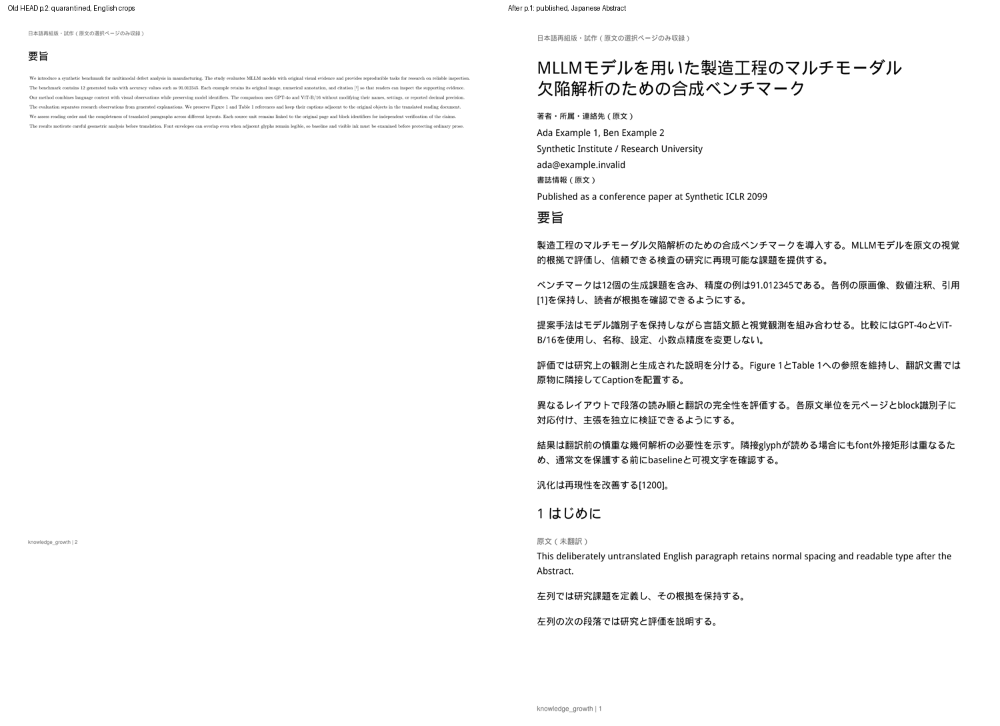
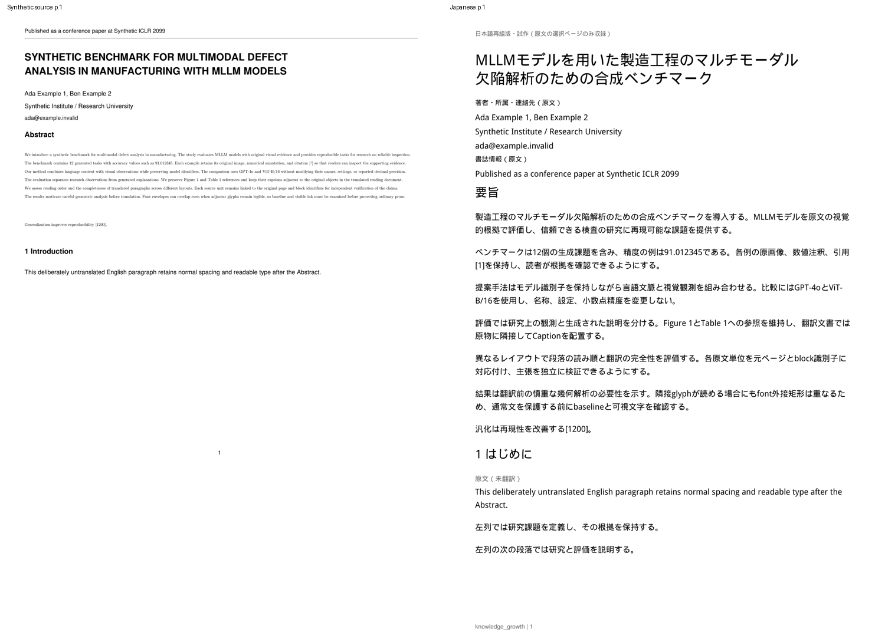

# 日本語PDF: 1,150文字Abstractのfont外接矩形による誤保護

既存Draft PR #9のT3-01 / T3-03継続修正。WindowsのMMAD原文p.1について、
1,150文字が翻訳前に保護されたという数値報告を受けたもの。
**MMAD原本・本文・画像はCloud/GitHubへ送信していない。修正後のWindows/MMAD/実ChatGPTは未検証。**

## 原因と修正前の再現

旧HEAD `404b382a7290e9425ad748161dbdbee2ca3e566d`を`git archive`で別ディレクトリへ展開し、
今回の生成fixtureだけをコピーして旧アプリのupload→detect→translate→generateを実行した。
通常英文Abstractの非空白文字数を正確に1,150、7原文blockへ分けた。
CMR10の埋め込みglyphプログラムを変えず、PDF側のfont descriptorのAscent/Descentを広げ、
baseline間15pt、font外接矩形の高さ19.44pt、隣接矩形の交差4.44ptを作った。
実際に描かれる文字は離れている。引用の上付き数字、短い44文字文のCMMI1文字、
学会header/横罫線・タイトル・著者・Introduction、別ページのFigure/Table/Equationを含む架空PDFである。
この実験は実MMADのfont命令の再現や調査を主張するものではない。

旧判定は`intersection.height > min(height) * .18`を満たすだけで2つのblock bbox全体を種領域へ入れる。
5組の隣接関係が6blockを結び、merge_regionsと本文bboxの反復取り込みへ進む。
残る44文字文は、通常proseの語数基準に届かず、部分的な数学fontから全体を保護した。
旧コードで実際に**overlapping_text 6領域・1,106文字、isolated_math_or_special_font 1領域・44文字**となった。
AIへAbstractが渡る前の誤保護であり、翻訳AIの失敗ではない。

旧生成は`visual_font_validation_unavailable`で公開拒否された。比較用Beforeは、
検証前に保存された**隔離PDF**をrenderしたもの。旧実装で公開に成功したとは扱わない。
[旧HEADの数値結果](assets/japanese-pdf/overlap-before-summary.json)を保存した。

## 判定方式

`japanese_overlap.py`の`glyph-ink-1`を翻訳準備に使用する。native-3の原物品質検証とは別工程である。

- immutableな元bboxの中に中心があるsource glyphを集め、空白以外のUnicodeが原blockと順序も含め一致するか確認する。
  元fontプログラムを使い、Unicode→glyph ID、advance、サイズ、origin、水平配置、不透明fillを検証する。
  曖昧な所属、Type3/未解決font、未対応transformは証明不能とする。
  PDF PostScript名と埋め込みfamily名のsuffix差は、唯一のfontプログラムに解決でき、glyph ID/advanceも一致する場合だけ許可する。
- 交差する**局所矩形だけ**に、元glyphを元位置で再描画する。288dpiのink maskを1pixel外側へ広げ、保守的に照合する。
  2つの復元maskの和が、その局所の原PDFの実描画と一致することも必須。
  baseline差だけで安全としない。外から交差する線や別glyph、未知の描画を無視しない。
- 原描画も一致し、両blockのink交差が0なら`font_envelopes_only`。ink衝突は`visible_text_collision`、
  証明不能なら`overlap_unproven`。後者2つは翻訳可能な通常文として通さない。
  左右列も実際のx座標とglyph所属を使い、本文順序は既存Semantic Assemblyの列順を維持する。
- 実画像・drawing・table・独立数式の積極的根拠を保護領域の種にする。巨大candidate bboxや単なる本文bbox交差からFigureを作らない。
  部分的なmath fontを含む短い普通文は、自身のglyph所属・通常語のまとまり・math glyphの比率から判定する。
  Abstractだけの例外、MMAD用の語句置換、交差しきい値の引き上げは使用しない。
- 保護対象のメンバーは、**種領域に直接触れるink**で決める。メンバーの共有によるgroup統合後、全文bboxへ1回だけ広げる。
  広げたcropに無関係な本文のinkが入れば、連鎖して取り込まず`visual_text_boundary_unresolved`で公開を拒否する。
  textだけの衝突をFigureにせずoriginal_textとする。元の注釈/曖昧Captionの原ページ保持も維持する。
- 比較最大512組/ページ、局所比較最大200万pixel。上限・証明不能を安全と読み替えない。
  組数超過は`overlap_proof_limit`で停止。内容検出段階の拒否では既存TranslationUnitを更新しない。

UIの折りたたみreportとjob reportには、kind/role/元ID、bbox寸法、glyph数、baseline差、
交差ink数、原描画一致、種/crop寸法、メンバー数、拡張回数、理由コードだけを追加する。
原文・訳・raw AI応答・font名/プログラム・画像・認証情報は出さない。

## タイトルの意味的な完全性

数値/引用/モデル等の既存検証に加え、paper_titleの成功前に**別のAI turn**で原題と訳題の意味対応を調べる。
同じAIRuntime/compat adapter、Codex app-server + ChatGPT planを使い、API key/固定モデル/従量課金providerは追加しない。
promptは`japanese_title_review_v0_1.md`、結果は`title-meaning-1`。

研究対象、適用領域、手法・モデル、研究の位置付け、固有名詞/識別子の5項目について、
covered/missing/uncertain/not_applicableと原文・訳文の根拠位置を厳密JSON schemaで要求する。
ID/全5項目の一意性/未知key/範囲/Unicode codepoint index/元の重要tokenの未対応を検査する。
根拠位置そのものはreportへ出さず、項目/状態/文字数/未対応token数のみ記録する。
重要要素の欠落は`title_incomplete`、不確実/不正/回数上限も専用safe codeとする。

「数値とMLLMは維持されているが研究対象を省いた日本語タイトル」という決定的fake応答を作り、
従来のhard token検査を通っても意味reviewで拒否されることを検証した。
そのタイトルだけ再試行し、他の正常訳は保存・再利用する。タイトルが失敗したら原題全文を通常textで保持する。
reviewは1タイトル最大4回、既存の全体48呼出し/600秒、1turn最大120秒にも含める。

既存AIタイトルの未検証cacheは初回再生成時にreviewし、通れば検証済みprompt markerで保存する。
既に検証済みなら再利用する。ユーザー編集済みタイトル/部分訳は変更せず、編集を意味review済みと偽らない。
新translation promptは`japanese_pdf_v0_5.md`。旧コードには記録version0.4なのにファイル0.3を読む不一致があり、
今回、実際に読むファイルと記録versionを0.5で一致させた。

意味reviewはAIの独立判断であり、完全な意味一致の数学的保証ではない。Cloudではfakeのみ。
実ChatGPTのspan根拠応答の互換性とMMADタイトルの品質はWindowsで確認する。

## 保存契約

**migration追加なし。schema v5、既存translationsとjob report_jsonを再利用。**
document_blocks、元bbox、SourceAnchor、original_block_ids、group hashの契約は不変。
同じ全文/groupの既存成功訳を再利用し、ユーザー編集を自動置換しない。
layout `reflow-4`で旧生成cacheを区別する。旧PDFは消さず表示/保存可能。
assembly `semantic-1`、extraction `glyph-spacing-1`、原物検査`native-3`を維持する。
日本語/英文本文11pt、自然な改ページ、Caption同ページ、atomic保存、再起動復元も維持する。
日本語fontは既存Droid Sans Fallback（Apache 2.0）。font binaryはGitへ追加しない。

## 合成fixture結果

文字数は**空白を除く原文文字数**。日本語化/配置も、対応する原文の文字数で示す。

| Abstractの指標 | 旧HEAD | 修正後 |
|---|---:|---:|
| 原文 | 1,150 | 1,150 |
| 翻訳候補 | 0 | 1,150 |
| 原物保護 | 1,150 | 0 |
| 日本語化 | 0 | 1,150 |
| 品質検証済みPDF配置 | 0（公開拒否） | 1,150（日本語1,150） |

隣接5組はいずれも局所の原描画一致、交差ink 0。通常baseline差は15ptで、上付き数字を含む組の最小差は13pt。
本文全選択は1,467文字/日本語1,371文字（93.46%）。意図的に未翻訳の英文96文字も11ptで保持。
Caption 56/56、100%。Figure/Table/Equationの3assetは全てvector/font/glyph/drawing/image一致。
200dpiの比較平均pixel差は3assetとも0。Tableのみ補正前0.00013、原点補正後0で既存の位相差検証を通る。
Captionは原物と同ページ。欠落/重複/用紙外/重なり/元ID二重対応0。
元PDF hash、document_blocks、source versionは不変。
再試行では15成功訳を再利用、タイトルのみ新たに成功、意図的未翻訳1単位を維持した。

原文2ページ相当→日本語5ページ。全ページを200dpiでrenderし、本文/英文fallback/原物/Caption/欠字/重なりを目視確認した。
原寸の図表を専用ページに置く既存方針のため、本文末尾や原物ページの余白は多い。
今回の修正はAbstract検出とタイトル検証に絞り、高度な図表の詰合せは行っていない。





全比較: [p.2](assets/japanese-pdf/overlap-comparison-2.png) / [Figure](assets/japanese-pdf/overlap-comparison-3.png) /
[Table](assets/japanese-pdf/overlap-comparison-4.png) / [Equation](assets/japanese-pdf/overlap-comparison-5.png)。
[Reader](assets/japanese-pdf/overlap-reader.png) / [数値診断と欠落タイトルの検出](assets/japanese-pdf/overlap-diagnostics.png) /
[安全なfixture report](assets/japanese-pdf/overlap-browser-report.json)。画像とJSONだけをGitに保存し、生成PDF/runtime DBは追加しない。

## テスト

- baseline全pytest **531 passed** → 修正後 **557 passed**、249.38秒、既存Starlette/httpx非推奨通知1件。
  追加26件。正常/失敗Abstract、真の文字衝突/図形交差、証明不能/上限、未関連文の連鎖防止、
  英文fallback、順序/欠落/重複/11pt、hash/元block/保存/再起動、read-only診断、
  タイトル欠落/部分成功/範囲捏造/JSON/timeout/不確実/budget/古い成功訳/ユーザー編集保護を検証。
- native-3検査コード/しきい値は変更していない。既存の小平均差でも数値精度・細線・画像・glyph/font・clip破損を拒否するテストを全て維持。
- Chromium: 新overlap **6**、reading10、semantic11、reflow17、翻訳診断8、原物/注釈9、Reader20、
  Import/Brief34、Structured Brief17、AI runtime12、計**144項目成功、各suiteのpageerror 0**。
  原物smokeはFigure/Table/Equationの実破損3件を全件拒否し、失敗PDFの404を確認。
  Phase 1のQ&A/Highlight保存・reload・選択・SourceAnchor fallbackも別途成功。
  原物smokeの呼出し数はtranslation turnと新title review turnを別に数える。
- 旧clip-before比較用の4296ff5エンジンだけを現在のSemantic Assemblyへ差し込む任意オプションは、
  metadata planの契約が異なる。本修正前の比較は404b382**全体**の別exportを使用し、
  原物browser回帰は現行エンジンで実行した。旧clip挙動自体は既存pytestで継続検証している。

```bash
.venv/bin/python -m pytest tests/ -q
.venv/bin/python scripts/smoke_japanese_overlap_browser.py --output /tmp/kg-overlap-browser
.venv/bin/python scripts/smoke_japanese_visual_browser.py --clip-repro --output /tmp/kg-visual-browser
```

## WindowsでMMAD p.1を再検証

1. アプリを終了し、既存branchを更新する。

   ```powershell
   git fetch origin
   git switch feat/japanese-pdf-prototype
   git pull --ff-only origin feat/japanese-pdf-prototype
   git rev-parse HEAD
   ```

2. `start_knowledge_growth.bat`で起動し、Codex app-server / ChatGPT planへ接続。
   MMADを開き「日本語版を試作」→対象`1`→「日本語PDFを生成」。履歴が**文字重なり検証版**であることを確認。
   旧成果物を選ばない。必要なら「失敗ブロックを再試行」を使う。正常な既存成功訳は再利用する。
3. 折りたたみreportのAbstractで、原文1,150に対し候補/日本語/保護/PDF配置の文字数を比較する。
   font外接矩形だけの交差が証明できれば、候補が増えるはずである。MMADで同じ結果になるとは未確認。
   未完了ならsafe codeを確認し、生成成功と日本語化完了を区別する。
4. タイトルの意味検証で、研究対象/適用領域/モデル/Benchmarkの位置付け/識別子がcoveredか確認。
   uncertain/invalid/incompleteなら原題全文を確認し、失敗単位のみ再試行する。ユーザー編集は上書きしない。
5. 日本語Abstractの順序/欠落/重複/11pt、英文fallbackのspace、元図表/小数/線/式/Captionを確認する。
   日本語の語を選択→「原文を見る」、検索、Brief Evidence、ノート/Highlightを確認。
6. 日本語PDFを保存して外部viewerで開き、アプリ再起動後も同じPDFが利用できることを確認。
   p.1合格後に2段組本文・評価表へ進む。

ローカルで追加の数値診断が必要な場合、URL `/#/read/<source_id>`のIDを使って実行できる。
アプリのdata保存先を変更している場合は、同じ`KG_DATA_DIR`を設定する。

```powershell
.venv\Scripts\python.exe scripts\diagnose_japanese_overlap.py --source-id "<source_id>" --pages 1 |
  Out-File -Encoding utf8 overlap-local.json
```

スクリプトは既存SQLiteを**mode=ro**で読み、PDFをメモリで検査するだけ。
AI呼出し/ネットワーク/再ingest/DB更新/原PDFの保存変更/画像出力は行わない。
baseline差・交差分類・glyph数・保護の直接メンバー数と拡張1回・境界未解決・Abstract文字数を出す。
ここでの日本語化/配置は0で、翻訳前の検出診断を示す。source ID不明/ページ不正等は固定safe errorのみ。
MMADのPDF/本文/画像/訳/raw応答/認証情報はCloudへ送信しない。

## 変更ファイルと制約

- 検出・proof: `app/japanese_content.py`, `app/japanese_overlap.py`。
- タイトル検証: `app/japanese_title_review.py`, `app/japanese_translation.py`, 新prompt2件。
- report/cache/画面: `app/japanese_pdf.py`, `app/japanese_semantics.py`, `app/routes_japanese_pdf.py`, `client/js/components/japanesepdf.js`。
- fake runtime: `app/llm/mock.py`, `app/llm/japanese_fixture.py`。
- fixture/tests: `tests/fixtures/japanese_overlap_factory.py`, 新overlap/title tests、既存PDF/semanticのversion期待値。
- scripts: numeric診断、新Reader smoke、既存reading/reflow/visualのversion・review呼出し期待値。
- 本記録/README/生成PNG・JSON。

任意のPDFでglyph所属・font・複雑transform/clip/混在描画を証明できるとは限らない。
その場合は保護・公開拒否が残る。しきい値緩和や原物検査省略で成功扱いにはしない。
タイトル意味reviewは追加のplan推論を使い、誤判定/厳しすぎる応答拒否も残り得る。
全文翻訳・OCR/VLM・高度な図表詰合せ・完全な意味同期は対象外。
**MMAD/Windows/実ChatGPTの成功は、上記手順でユーザーが再確認してから判断する。**
