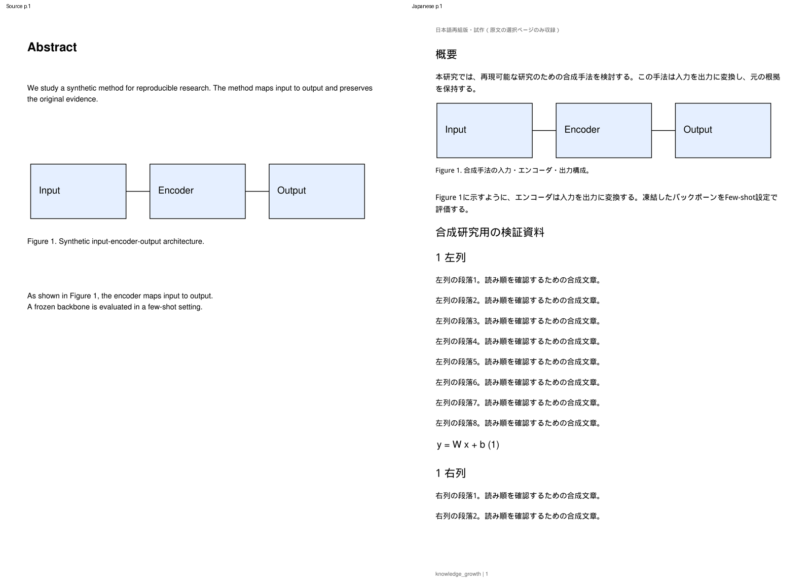
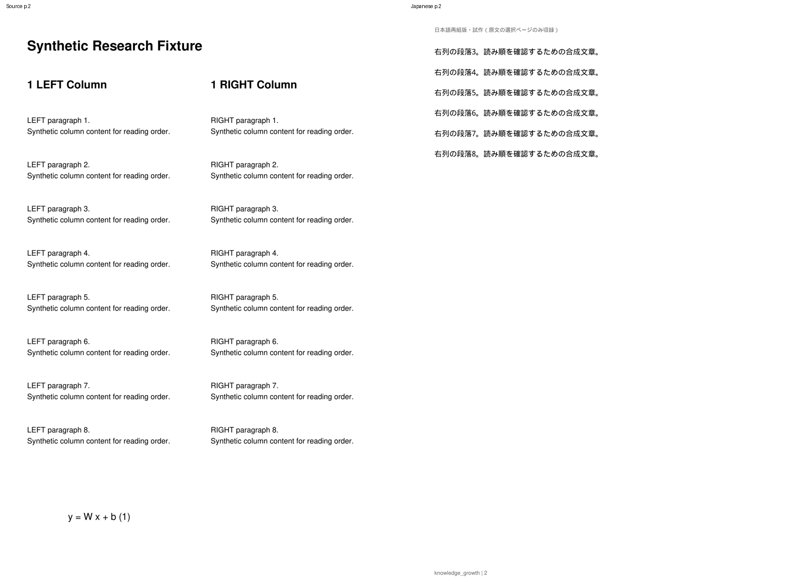
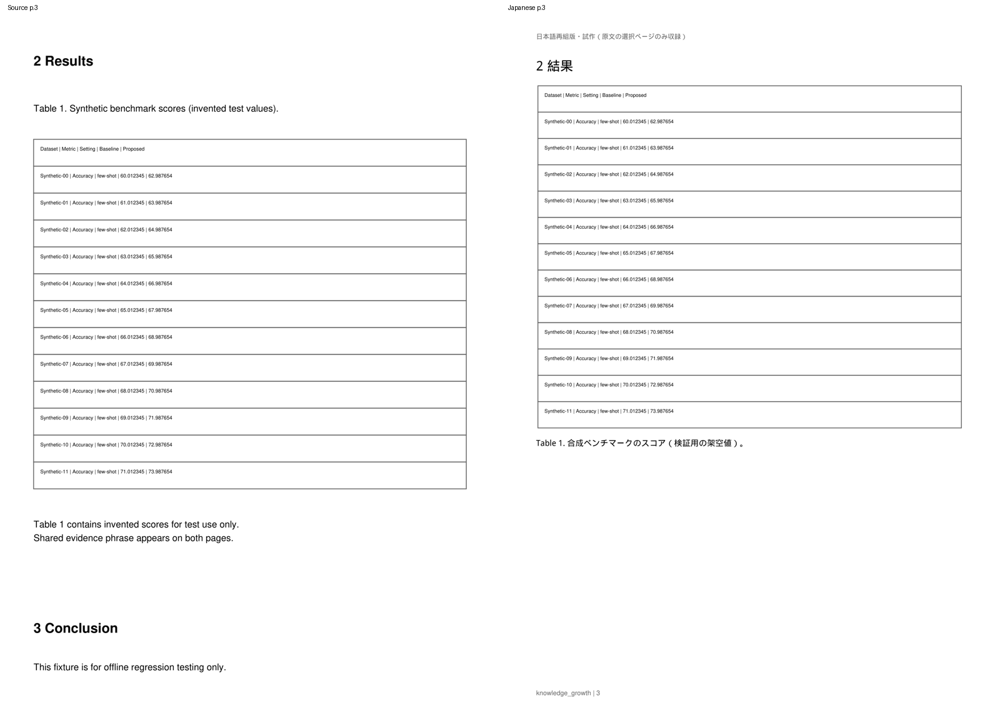
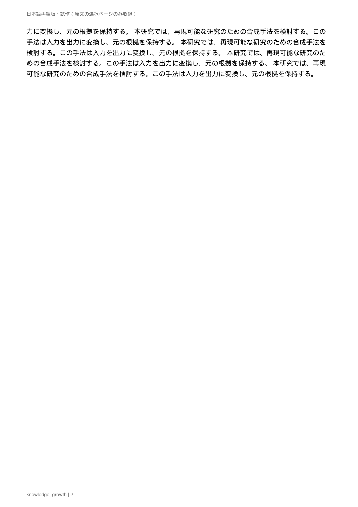

# 選択ページ相当の日本語PDF再組版 — Phase 3-2

更新: 2026-10-13。T3-01 / T3-03 PoC、Draft PR #9。
固定bboxへの原文置換を廃止し、内容と原物を保持する再組版へ変更した。
Cloudで使ったのは独自の生成PDFと決定的mock訳のみ。
Windows実機・MMAD・このPRの実ChatGPT翻訳品質は未確認で、merge前に確認する。

## 方針と画面

優先順位は意味の正しい日本語化、Figure/Table/Equationの内容保持、Captionとの隣接、
Sectionと段落の自然な読み順、可能な範囲で原論文に近い外観。
元のページ数、段組、段落bboxとの一致を求めない。

Readerの「日本語版を試作」を開き、**原文PDFのページ番号**を`1,3,7`または`1-3`で指定する。
最大3ページ相当の内容を選んで「日本語PDFを生成」→「日本語PDF（試作）」で読む。
対象外の原文ページは派生PDFには収録しない。派生ページ数は増減する。
「日本語試作・一部ページのみ翻訳済み」、原文の選択ページ、日本語ページ数、
対象本文/Captionの翻訳数、原物保持・未解決の理由を表示する。
生成PDFにも選択ページのみの試作であることを示すheaderを付ける。

「原文PDF」で原文へ戻り、zoom / fit / パネル状態を保持する。
日本語の文字選択では「原文を見る」から対応する**原文block_id**へ戻る。
図表内の選択も原物の配置対応から元のcell/figure blockを探す。
日本語文字のbboxをSourceAnchorに保存しない。
原物画像を選択できない場合も、理由一覧の「原文図表を見る」から戻れる。

日本語表示中の文書内検索はPDF.jsの実PDFテキストを検索する。
未描画ページも検索対象にし、日本語本文と保持した英語モデル名・数字を検索できる。
元のSection見出しに対応する日本語PDF bookmarkも作る。
「日本語PDFを保存」で外部viewerへ開け、生成履歴は再起動後も再利用できる。

## 再利用・migration・旧版互換

TranslationUnitは既存`translations`を再利用する。
source_id / version_id / block_id / source_text / translated_textに、v5で追加した
original_page / original_bbox / source_hash / provider / runtime / model / prompt_version /
created_at / updated_at / translation_status / reasonを保持する。
既存の訳、user_edited、Note、Highlight、Brief、Evidenceを消さない。

再組版の配置は生成PDFごとに変わるので、`japanese_pdf_generations.report_json`に保存する。
**追加migrationは不要。v5のSQLを変更していない。** mainのv4から初回導入する場合は
既存のv5 migrationと移行前backupが実行される。すでにv5なら追加のDB移行はない。
訳文を保存する新しいテーブルも追加しない。

| reportの項目 | 用途 |
|---|---|
| layout_version = reflow-1 | 固定bbox版と新方式のキャッシュを区別 |
| units[].block_id / translation_id | 既存原文block・TranslationUnit |
| units[].page / bbox | 原文の正本geometry（既存SourceAnchor契約） |
| units[].placements[] | 日本語ページ、bbox、分割段落のpart |
| units[].asset_id / section | 対応する原物IDとSection |
| assets[] | 図表/数式のsource page/bbox、原文block IDs、Caption IDs、配置、未解決理由 |
| quality / reading_order | 本文の検査、原物の品質、出力の読み順 |

旧固定bbox版の生成PDFとreportは削除しない。履歴では「旧座標版」と表示し、
同じsource/version/hashである限り再表示・ダウンロードできる。
ただし新しい生成で旧版の完成PDFをキャッシュとして返さない。
旧訳は正確なsource/version/block/原文が一致すれば再利用し、旧overflowの訳も再組版へ流せる。

AIRuntime → RuntimeProvider、Codex app-server + ChatGPT plan、既存security isolation、
JSON schema・block ID・数値token検証、finite batch/retryを維持した。
モデルをハードコードせず、従量課金APIやAPIキーを追加していない。
`prompts/japanese_pdf_v0_1.md`はそのまま研究翻訳に使用する。
本文はuntrusted user JSONで、通常ログへ原文・訳文・AI応答を出さない。

## 内容・原物・Captionの検出

`app/japanese_content.py`が元のdocument_blocks.idxの読み順で内容を計画する。
画像、全drawing、表候補、PyMuPDFの表検出、数式/数学フォント/上付き文字を調べる。
罫線なし表では、横に並ぶ数値とモデル名、その近くのheaderを一緒に保護する。
交差する原物領域は結合し、その領域内の文字もまとめて原物に含める。
元のfigure/table/equation候補フラグだけを完全な判定とは扱わない。

図表の近くにある独立したCaptionを関連付ける。
ラベル付きの最初の行でCaptionが分割されている場合は、近接・整列した未完の続きもまとめる。
図表と複数のCaptionが競合する、図内Captionを安全に分離できない、
geometryがない、表検出が失敗する場合は、その**選択原文ページ全体**を原物として保持する。
この場合は未解決と表示し、Caption対応を確定したとは扱わない。
図内文字・表のcell・数式を翻訳しない。数学を含む一塊の本文も原物を優先する。

Section情報は原物内部のモデル名等を見出しとして使わず、再組版する見出しの順序で割り当てる。
元のDBとSourceAnchorのheading/bboxを変更しない。
読み順の品質は既存の列を考慮した抽出に依存し、VLMによる意味解析は実装していない。

## 再組版エンジン

`app/japanese_pdf.py`が白紙の派生documentを作る。原文PDFへredactionや上書きをしない。
本文はPyMuPDF Storyで**11pt、line-height 1.6**、見出し16pt、Caption10ptで配置する。
残りの領域に収まらなければ次ページへ流す。文字サイズを下げる処理はない。
段落が複数ページになる場合は同じ原文block_idに複数のplacementsを保持する。
本文が元のbboxに収まらないという理由で翻訳を諦めない。

原物はsource clipと交差するdisplay-list操作を新しいvector PDFへ描き出し、
`show_pdf_page`でベクターと画像をコピーする。表示clipだけに頼るとPDF.jsが領域外の
非表示原文まで抽出するため、不要な原文をコピー先のresourceに残さない。1つのtext描画操作が領域内外にまたがる場合は、
切り出した一時PDFの領域外glyphだけをtext-onlyで除去する。原文PDFにはこの処理を行わない。
元のpointサイズを保つ。本文領域に対して大きな表・図は専用ページに置き、
必要ならページの幅・高さを増やす。図表とCaptionを同じページの一体のgroupとして配置する。
直前のSection見出しも可能な範囲でgroupと一緒に置く。

元PDFに表示する注釈がある場合は、`show_pdf_page`が注釈を複製しないため、
元ページ全体の200dpi表示を重ねて保持し、未解決と表示する。
この場合はvector_preserved=falseを記録し、下の同じvector textを選択・検索用に保持する。
通常の図表・数式ではベクターを保持し、再描画時の画質を保つ。

翻訳が不確実・失敗・欠字の場合は原文表示を配置し、理由を残す。
Captionの翻訳失敗時もCaptionを落とさず、同じ図表の近くに原文を配置する。
原物保持・未解決の表示もPDF内に残す。
旧overflow statusはデータ互換のため残るが、新本文をbbox不足でoverflowにしない。

日本語フォントはPyMuPDF組込みDroid Sans Fallback Regular（Apache 2.0）。
実行時に一時font archiveを作り、PDFに埋め込む。Windowsのシステムフォントには依存しない。
font binaryはGitに追加せず、[NOTICEと全文license](../../licenses/droid-NOTICE.txt)を
リポジトリと生成PDFの添付へ保持する。原文font resourcesを再subset化しない。

## API・Reader・対応ジャンプ

APIのpathと生成/保存の契約は維持する。

| API（先頭`/api/sources/{source_id}`） | 用途 |
|---|---|
| POST /japanese-pdf/generate | 原文pagesを最大3つ、retry_failed。202 |
| GET /japanese-pdf | not_generated / generating / preview_ready / failed、履歴・report |
| GET /japanese-pdf/{generation_id}/file | 表示用PDF |
| 同path + ?download=true | attachment download |

source/version/hash/抽出digest、所有関係、file hashの照合、path traversal防止、
同じsourceの同時生成制限、fsync→atomic replace→DB確定を維持した。
新方式の版を確認して完成PDFを再利用する。失敗時は原文・Brief・Noteを変更しない。
中断jobは起動時にfailedへ回復し、完成PDFは再利用できる。

Readerは1つのPDF.js controllerを維持する。
`client/js/pdfalignment.js`がsource blockとplacementsから対応する位置を求める。
原文ページ番号と日本語ページ番号の一致を前提にしない。原文回転も考慮する。
長い段落の細かい意味位置は確定せず、同じ元ブロックへ戻る。
対象外の原文ページから日本語へ切り替える場合は近い対象を表示し、その旨を通知する。

`kg.reader.<sourceId>.pdfViews`へ原文と生成IDごとの日本語位置を保存する。
旧pdfViewも互換で保持し、zoom / fit / side panelを維持する。
Paper Brief・Note・Q&A・HighlightからのEvidenceは必ず原文へ切り替えてから解決する。
日本語ページ/文字bboxを原文SourceAnchorに保存しない。

## 検証基準と結果

「元の本文bbox外の差分0」は新方式の基準から削除した。
保存済みPDFを開き直し、次を確認する。

- 元PDF bytes/hashが不変。
- 翻訳済みunitの全fragmentの抽出文字が、保存した日本語と一致する。欠落・重複を拒否する。
- 全配置が用紙の内側にあり、item同士が重ならず、元の本文/Section順序で流れる。
- 図表とCaptionが同じページにあり、対応する原文IDsを持つ。
- 図表/数式の数値・文字を元clipと照合し、元サイズとvectorを保持する。
- 原物のclipを200dpiでrenderし、移動後clipと比較する。native raster phaseを揃え、
  平均pixel差が0.2/255を超える原物は公開しない。本文の再組版領域はこの比較対象にしない。
- AI JSONの不正、欠落/重複/架空ID、数値改変を拒否し、失敗/retry/cache/user edit保持を確認する。
- 旧固定bbox成果物、stale/corrupt file、atomic失敗、再起動、SourceAnchorの回帰を確認する。

主fixtureはAbstract、2段組、Figure＋Caption、数式、罫線付きTable＋Captionを含む原文3ページ。
**日本語は4ページ**になり、本文・見出し・Caption **28/28対象を日本語化**。
原物内部を含む19blockは保護表示し、Figure/Table/Equationの3原物を保持した。
欠落・重複・overlap・用紙外配置は0。原物の平均pixel差はすべて**0.0**、数字・文字も一致した。

別の長文fixtureでは、原文1ページ相当を**日本語2ページ**へ流し、本文11ptを維持した。
より長い決定的訳のテストでも複数ページへ配置し、overflowや縮小なしで全文抽出を確認した。
Caption継続、対応の曖昧な2つの図、罫線なし表、接近/重複、CropBox＋90/180/270度回転、
注釈の表示保持、欠字、文字なしPDFも検証する。

固定bbox版baseline pytestは**376 passed**。最終pytestは**390 passed**。既存Starlette/httpx非推奨通知1件。
Chromiumの新再組版browserは**17項目成功**、Reader回帰20、Import/Brief34、Structured Brief17項目成功。
各suiteのpageerrorは0件。日本語検索、選択、原文p.2→日本語p.1の対応、Evidenceの原文p.3への復帰、
artifact別の位置復元、download、長文改ページ、連続20回切替を確認した。

画像を目視し、日本語の行送り、文字サイズ、欠け・二重表示・重なりがないこと、
原物とCaptionの隣接、元の数式・表の表示を確認した。
比較画像の左右はページ番号が独立しており、同じ番号同士の意味対応を表すものではない。






[ブラウザ・配置・原物品質report](assets/japanese-pdf/browser-report.json)。
生成PDF自体はruntime fileとして扱い、Gitへcommitしない。

再現:

```bash
.venv/bin/python -m pytest tests/ -q
.venv/bin/python scripts/smoke_japanese_pdf_browser.py --chromium /usr/bin/chromium
```

browser scriptは一時dataのmock serverを自動起動し、DBを終了時に削除する。
画像・report・download PDFの既定出力はOS一時directoryの`kg-japanese-pdf-smoke`。
Playwright/Chromiumは任意の開発依存で、`--output`と`--chromium`で場所を指定できる。

## Windows / MMAD確認手順

1. アプリを終了して既存branchを更新する。PowerShellでリポジトリへ移動し、
   `git fetch origin`、`git switch feat/japanese-pdf-prototype`、
   `git pull --ff-only origin feat/japanese-pdf-prototype`。
   未commitのローカル変更がある場合は上書きせず、gitの表示を確認する。
2. `start_knowledge_growth.bat`で起動する。ChatGPT planの接続状態を確認する。
   初回のv4→v5のみDB backup/migrationが走り、既存v5では追加migrationはない。
3. 登録済みMMADを開き、「日本語版を試作」でAbstract、本文、Figure/Tableのある
   **原文ページ番号**を1〜3つ指定する。非連続の`1,3,7`等も使える。
4. 「日本語PDFを生成」を押す。旧座標版があっても新しい再組版を生成する。
   完了したら「日本語PDF（試作）」を押す。日本語ページ数が原文と異なってよい。
5. 本文が自然な順序で流れ、文字が小さくなりすぎず、欠け・重なり・欠落がないことを確認する。
   長い段落が次ページへ続くこと、Section順序、図表と日本語Captionが隣接することを見る。
6. 表のモデル名・小数値・罫線、グラフ、数式が原文と同じ内容か確認する。
   「原文との対応・原物保持・未解決の理由」で対応と未翻訳理由を確認し、
   「原文図表を見る」から正しい原物へ戻る。
7. 日本語本文を選択→「原文を見る」で元段落へ戻る。原文から日本語へ切り替えて
   同じブロックへ戻ること、zoom/fit/パネル状態を維持することを確認する。
   Paper BriefのEvidenceは日本語表示中でも原文の正しい段落/図表へ戻ることを見る。
8. 日本語表示中に文書内検索で日本語語句、表のモデル名・小数値を検索する。
9. 「日本語PDFを保存」で外部PDF viewerへ開き、日本語選択/検索、bookmark、
   Captionと図表、本文改ページを確認する。
10. アプリを終了・再起動し、完成PDFを再表示・downloadする。
    既存Paper Brief、Note、Highlight、Import、Q&Aも利用できることを確認する。

MMADをGitHub/Cloudへ送信しない。Windowsでの結果をPRへ記録してからmergeを判断する。
Cloudのfixture成功を実論文の品質確認済みとは扱わない。

## 制約と次段階

最大3原文ページ、160領域・24batch、最大64生成ページ。
原物の200dpi検査は1,600万pixelまで。上限超過は固定エラーで失敗し、元データを保持する。
原物とCaptionの判定は保守的な幾何・文字解析で、複雑な領域は原ページ表示になる。
該当領域に本文が含まれていれば、その本文も英語のまま原物に残る。
複数の原文ページへまたがる図表の自動結合は未対応。

原文の抽出読み順が誤っている場合の完全な意味復元、OCR/VLM、図表内部の翻訳、
表cell構造化、全文一括翻訳、左右比較、文中の細かい意味位置同期は未実装。
長文の原文→日本語ジャンプは対応段落の最初のfragmentが基本で、完全な文単位同期ではない。
日本語からHighlight/Q&Aを直接保存する操作はまだ追加せず、原文へ戻った後に既存操作を使う。
既存Paper Briefの「日本語版で読む・今後対応」CTAは変更せず、Reader toolbarから試作する。

次はWindowsのMMADで品質を確認し、問題を独自の最小fixtureへ再現して改善する。
