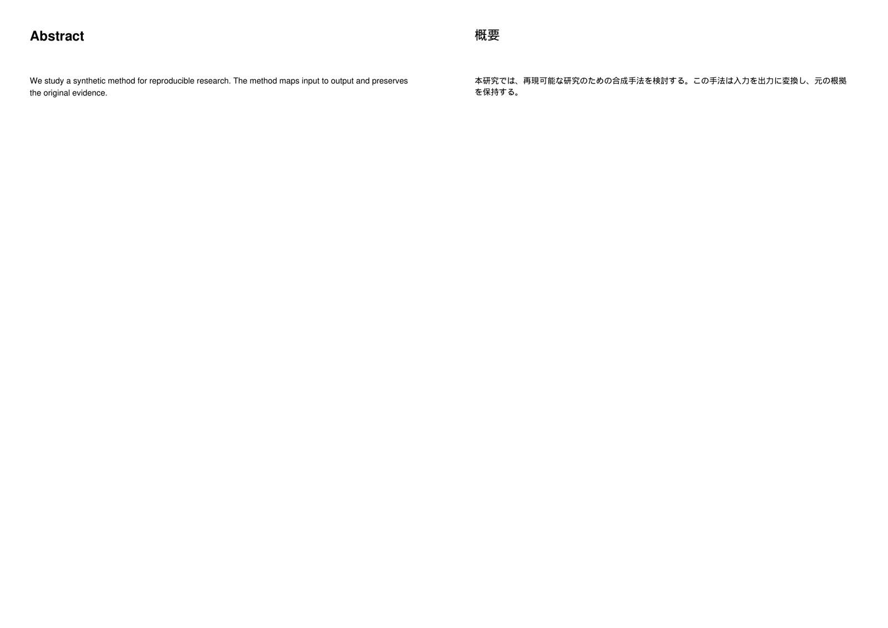
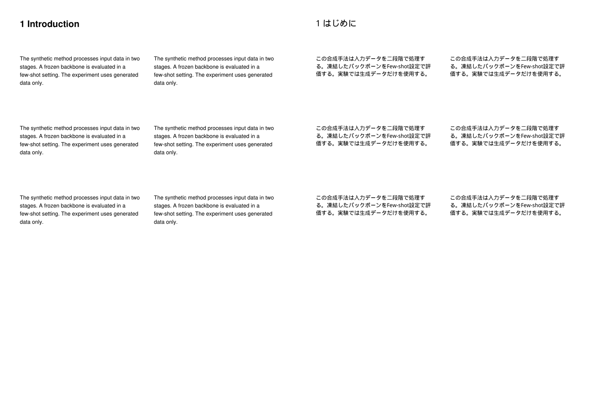
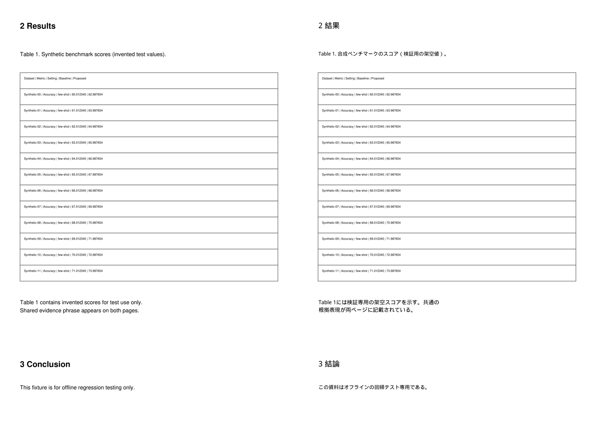
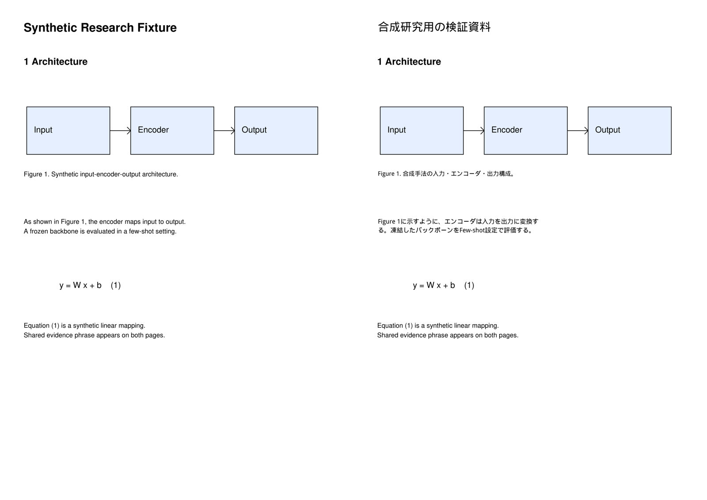
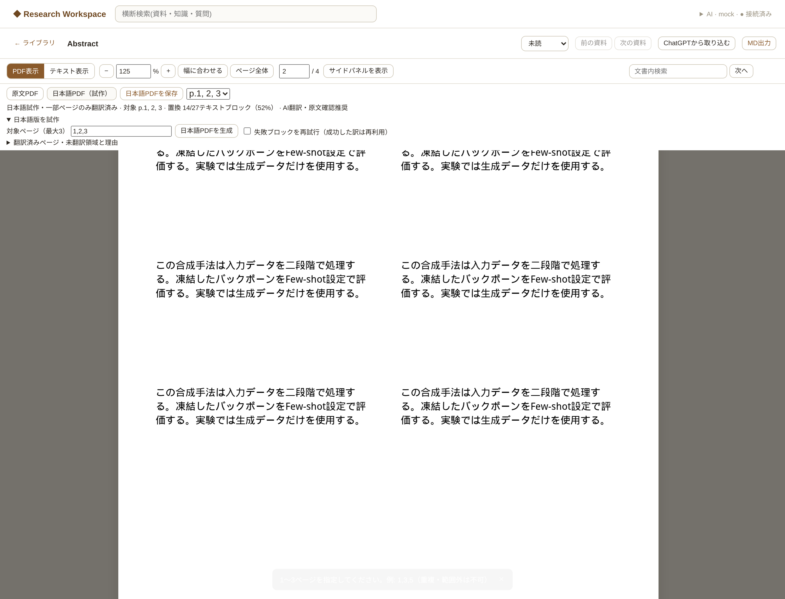

# 選択ページの日本語PDF試作 — Phase 3-2

更新: 2026-10-13。T3-01、T3-03の最大3ページPoC。
基点は最新mainの`a93556be1218c717c10470d78ab803c1f24e9db2`（PR #8 merge）。
Windows実機・MMAD・実ChatGPT翻訳の品質はこのPRでは未確認。
Cloudでは独自に生成したPDFと決定的なmock訳だけを使用した。

## 画面でできること

PDF Readerの「日本語版を試作」を開き、`1,3,5`や`1-3`で対象を指定する。
最大3ページを翻訳して、ページ数・順序を変えずに派生PDFを保存する。
「日本語PDF（試作）」と「原文PDF」で同じページ内の相対位置へ戻り、
zoom / fit mode / サイドパネルの開閉とタブを保持する。
「日本語PDFを保存」でダウンロードでき、再起動後も生成済みファイルを選べる。
異なる対象ページセットの生成履歴も選択できる。

「日本語試作・一部ページのみ翻訳済み」を常に表示し、置換率と対象ページを示す。
理由一覧の「原文を見る」は該当する原文blockへ移動する。
対象外ページ、保護領域、overflow、失敗箇所は英語のまま残る。
日本語のTextLayerは選択・コピーでき、PDFから日本語を抽出できる。
日本語選択からの操作は「原文を見る」に限定した。原文へ戻った後、既存の質問・
Highlight・保存を使える。派生PDFの文字bboxをSourceAnchorへ保存しない。

PDF表示／テキスト表示は従来の表示方法の切替で、その下の英日ボタンはPDFの言語切替。
Paper BriefのEvidence、ノート、Q&A、既存Anchorは引き続き原文を正本とする。
Evidence navigation時は原文をmountしてから既存resolverで座標を解決する。
PDF.js controllerは同時に1つだけ。mount/unmount契約を維持した。
PDF.js 4.x内部のfetch readerが連続切替時に中断promiseを未処理にするケースを避けるため、
Reader自身がAbortController付きfetchをawaitし、取得したPDF bytesをPDF.jsへ渡す。
このためPDF全bytesを取得してから表示を開始する。ページcanvasの既存上限は維持するが、
PDF全体の受信buffer・workerを含むメモリ量の上限ではない。

## TranslationUnitとmigration v5

`translations`を拡張した。翻訳本文を保存する別テーブルは追加していない。

| TranslationUnitの情報 | 保存先 |
|---|---|
| source / source version / original block | 既存source_id / version_id / block_id |
| 原文・訳文 | 既存source_text / translated_text |
| ページ・原文bbox | original_page / original_bbox（既存geometry JSON契約） |
| source hash | source_hash（原PDF bytesのSHA-256） |
| provider / runtime / model / prompt | provider / runtime / model / prompt_version |
| 状態・理由 | translation_status / reason |
| 作成・更新日時 | created_at / updated_at |

状態は`translated`、`skipped_protected`、`skipped_unsafe`、`overflow`、`failed`。
元のブロックがfigure/table候補で文字を持たない場合も保護結果を記録する。
通常の段落翻訳APIも同じ保存関数を使用し、source/blockの所有関係を確認する。
空のskip行を段落翻訳キャッシュとして返さない。

既存の訳は同一source/version/block/原文が一致する場合に再利用する。
legacy行のhashがNULLでも同じversionと原文を確認する。
user_editedを優先し、訳文・provider/model・作成日時を自動上書きしない。
既存の重複行を削除したり、移行時にunique制約を追加したりしない。
PDF生成の配置結果とreasonは更新するが、生成履歴には各時点のimmutableなreportを保存する。
失敗した配置でも翻訳本文を残し、再生成でAIの成功結果を再利用できる。

新しい`japanese_pdf_generations`は生成履歴、source/version/hash、抽出ブロックのdigest、
対象ページ、file hash、report、状態だけを保存する。訳文の二重保存はしない。
1つのsourceで同時に実行できる生成は1つ。同一hash/version/digest/ページセットの
完成PDFを再利用する。再試行指定では新しい生成履歴を作り、成功した訳を再利用する。

append-onlyの`005_japanese_pdf.sql`でv4→v5へ移行する。
既存Note、Highlight、Paper Brief、Evidence、訳文を保持し、migration runnerが移行前DBをbackupする。
legacyのcreated_atはupdated_atから補完する。過去のprompt/runtimeが不明な行には架空の生成情報を補わず、NULLを保持する。復旧はv4 backupと旧アプリを組み合わせる。

## 翻訳と保護判定

AIRuntime → RuntimeProviderを通じて既存のCodex app-server + ChatGPT planを使用する。
モデル指定を追加していない。従量課金API、APIキー、追加MCPは使用しない。
既存security isolationを維持し、promptは`prompts/japanese_pdf_v0_1.md`に置く。
論文本文はuser側のuntrusted JSONデータとして渡し、本文内の指示を実行しない。
通常ログに原文・訳文・モデル応答を出さず、APIエラーは固定codeだけを返す。

Pydanticのstrict schemaとJSON parserで余分なfield、不正JSON、重複keyを拒否する。
入力と出力のblock ID集合を照合し、架空ID・欠落・重複を拒否する。
数字・小数点精度・引用番号に使われる数値tokenも照合し、変化を拒否する。
モデル名・Dataset・Metric・単位・Figure/Table参照の維持はpromptで指示する。
翻訳が不確実な応答は配置しない。最大8block / 6,000文字のbatch、1blockは最大5,000文字。
最大160領域・24batch・各batch最大2回（最大48turn）に制限する。
有効に翻訳できたblockは先に保存し、不確実なblockだけ次の試行へ送る。
JSON契約全体が不正なbatchは、そのbatchを拒否して有限回で打ち切る。

元のroleに加え、画像bbox、全drawing（細線も含む）、表検出、注釈・リンク、
数式・数学フォント・上付き文字、隣接span、重複blockを確認する。
罫線のない表では、横に並ぶ短い領域に数値cellがある行や短いラベルを保護する。
画像・線・表の周囲には2ptの保護余白を設ける。
Captionは図表と独立している場合に翻訳する。
方向が横書き以外の文字、曖昧な領域、表検出失敗、数式混在の見出しは原文を残す。
この判定は高度な図表解析ではなく、保守的なPoCの判定である。

## PDF置換・フォント・overflow

元PDF bytesを変更せずに別documentを開く。
各blockのscratch pageで、原文bboxのtext-only redactionと日本語配置を試す。
`fill=False`を指定し、白い矩形で背景を塗らない。
`apply_redactions(images=0, graphics=0, text=0)`で画像・ベクターを保持する設定を明示する。
redaction後の領域に原文文字が残れば失敗とする。

`insert_htmlbox`でHTML escapeした訳文を配置する。
line-heightは1.4、段落のmargin/paddingは0、HTMLboxの既定body余白1pxを保ち、元spanの文字サイズを基準にする。
最大15%まで縮小し、最小8.5ptを守る。領域外のglyph bbox、欠字、文字抽出不一致を拒否する。
収まらない場合はscratchを破棄し、元の英文と`overflow`を残す。
余白の自動拡張、別ページへの送り、図表の移動はしない。

日本語フォントはPyMuPDF組込みのDroid Sans Fallback Regular。
Windowsのシステムフォントに依存せず、実行時にfont bufferを一時的なarchiveへ取り出す。
PDF内にフォントを埋め込み、同一streamをdeduplicateする。元のフォント資源を保つため、文書全体の再subset化はしない。フォントbinaryはGitへ追加していない。
DroidはApache License 2.0。著作権表示と全文licenseを
[docs/licenses/droid-NOTICE.txt](../../licenses/droid-NOTICE.txt)に保持し、
生成PDFにもNOTICE添付を埋め込む。出典は
[MuPDFのDroid NOTICE](https://github.com/ArtifexSoftware/mupdf/blob/master/resources/fonts/droid/NOTICE)。
PyMuPDF本体の既存AGPL/commercial license契約とは別に扱う。

MediaBox / CropBox / rotationとページ数・順序を保存する。
回転＋CropBoxでは置換時だけrotationを0にし、処理後に戻す。
これはPyMuPDFの当該組合せでの配置matrixのcrop offset差を避けるためである。
原文bboxは未回転のCropBox左上原点・pt単位の既存契約を維持する。

## API・ファイル永続化

| Method / path（先頭は`/api/sources/{source_id}`） | 用途 |
|---|---|
| POST `/japanese-pdf/generate` | `{pages:[1,3], retry_failed:false}`、202応答 |
| GET `/japanese-pdf` | not_generated / generating / preview_ready / failedと履歴、report |
| GET `/japanese-pdf/{generation_id}/file` | PDF.js向けのPDF |
| GET `/japanese-pdf/{generation_id}/file?download=true` | attachmentでダウンロード |

`KG_DATA_DIR/generated/japanese_pdf/{generation_id}.pdf`へ保存する。
生成IDはサーバーが発行する16桁hexで、任意のパスを受け付けない。
元ファイルのパスもfiles directory内に制限する。
source ownership、最新version、実bytes hash、抽出blockのdigestを開始時・確定時・取得時に照合する。
変更した元PDFや抽出blockに対応しない古い成果物はlatest扱いせず、取得も409で拒否する。

同じdirectoryの一時PDFへ保存し、正常に開くこと、geometry、抽出、pixel検査を確認する。
fsync → os.replace → DBのpreview_ready確定の順で公開する。
失敗時は未公開ファイルを削除し、原文・Brief・Noteは変更しない。
再起動時のgeneratingはinterruptedとしてfailedへ移す。完成ファイルは再利用できる。
完成後にファイルを失った／変更した場合もhash照合で拒否する。
単一local app processの運用を前提にする。OSの強制終了で未参照の一時・確定ファイルが
残る場合はあるが、DBの完成状態と照合できないファイルを配信しない。

## 自動品質と目視検証

保存済みPDFを再度開き、元PDFと約200dpiでrenderする。
翻訳対象ページ全体の差分を測定し、置換済み原文bbox以外の差分が1pixelでもあれば生成失敗にする。
rasterのantialiasingのため、許可maskに0.5ptの境界余白を付ける。
実際のglyph extentsは原文bbox内を0.1ptの丸め許容で確認する。
画像・線・表は2pt保護余白と交差判定を先に行う。
対象外ページはcontent stream bytesの不変を検査し、fixtureテストでは全pixelの一致も検査する。
Figure/Table/Equationの保護領域は別途200dpiのpixel完全一致を検査する。

テストは通常英文、2段組、Figure＋Caption、罫線付き表、モデル名と小数値、罫線なし表、数式、
数式混在の見出し、長い日本語overflow、欠字、回転・CropBox、図表と文字の接近・重複、文字なしPDFを含む。
原PDF hash、不正AI JSON、finite retry、successful cache、user edit保持、stale source、
file corruption、atomic確定失敗、許可領域外の意図的変更、再起動回復も検証する。
実ChatGPTログインはCIで不要。

main baselineは**330 passed**。最初の環境にはjsonschemaがなく、requirementsの依存を導入して再確認した。
最終pytestは**376 passed**。既存Starlette/httpxの非推奨通知1件。
ブラウザでは新日本語PDF **18項目成功**、Reader回帰 **20項目成功**、
Import/Brief **34項目成功**、Structured Brief生成 **17項目成功**、
Phase 1のPDF選択・Highlight・Q&A・Anchor fallbackも成功した。各suiteのpageerrorは0件。

3ページlayout fixture（4ページPDFのp.1/2/3を選択）の結果:

| ページ | 置換 | 保護skip | 理由 |
|---|---:|---:|---|
| p.1 Abstract | 2 | 0 | 見出しと本文を置換 |
| p.2 2段組 | 7 | 0 | 見出しと左右の本文を置換 |
| p.3 Table | 5 | 14 | table候補1領域、罫線・表と交差する13文字領域 |

文字を持つ27block中14blockを置換、**51.9%**。
安全に分離できた14対象はすべて置換した。overflow/failed/skipped_unsafeは0。
p.4は原文のまま。p.1/2/3の許可領域外pixel差分はすべて**0**。

Figure/Equationを含むreader_detail fixtureは27文字block中8block置換、**29.6%**。
保護skip19（図表候補・数式3、画像/線/表交差16）、overflow1、failed1。
overflowは日本語のArchitecture見出しが幅に収まらず原文を維持した。
failedは決定的mock辞書にない本文で、実AI翻訳の品質評価ではない。
両ページの許可領域外pixel差分は**0**。図・数式・表は保持した。

比較画像（左が英語、右が日本語、元renderは200dpi、掲載画像は縮小）を目視し、
日本語本文の可読性、2段組、文字欠け・二重表示がないこと、表・数式が同じ見た目であることを確認した。







詳細は[ブラウザとpixel品質report](assets/japanese-pdf/browser-report.json)。
生成PDF自体はruntime dataとして扱い、Gitへcommitしていない。

再現:

```bash
.venv/bin/python -m pytest tests/ -q
.venv/bin/python -m pip install playwright
.venv/bin/python scripts/smoke_japanese_pdf_browser.py --chromium /usr/bin/chromium
```

browser scriptは一時dataでmock serverを起動し、終了時にDBを削除する。
画像・report・ダウンロードしたPDFは既定でOSの一時directoryの`kg-japanese-pdf-smoke`へ出力する。
`--output`で出力先を指定できる。Chromiumが自動検出できないWindowsでは、
Playwrightをinstallした後、Chromium実行ファイルの絶対pathを`--chromium`へ渡す。

## Windows / MMAD acceptance（merge前に実施）

1. 現在のアプリを終了し、mainを変更せず本PRのbranchを取得する。
   `git fetch origin`、`git switch feat/japanese-pdf-prototype`で切り替える。
   既存dataを保持して`start_knowledge_growth.bat`で起動する。
   v5 migration前のbackupは`data/backups`へ自動保存される。
   既存venvの依存が足りない場合は`.venv\Scripts\python.exe -m pip install -r requirements.txt`を実行する。
2. AI状態メニューでChatGPT planの接続を確認し、登録済みのMMADを開く。
   MMADをGitHubやCloudにアップロードしない。
3. PDF表示で「日本語版を試作」を開き、Abstract、2段組本文、評価Tableがあるページを
   **PDFの1-basedページ番号**で入力する。例えば`1,3,7`のような非連続指定ができる。
4. 「日本語PDFを生成」を押す。生成中は原文を閲覧できる。
   完了後「日本語PDF（試作）」を押し、対象ページと置換率を確認する。
5. 表のモデル名、数字、小数点精度、罫線、図・数式が元のままか確認する。
   「翻訳済みページ・未翻訳領域と理由」でskip/overflow/failedを確認し、
   各「原文を見る」で該当箇所へ移動する。全文翻訳済みと解釈しない。
6. 100%/125%/幅に合わせるで日本語の文字サイズ、欠字、欠け、二重表示、重なりを確認する。
   英日を往復して同じページ内の近い位置へ戻ること、zoom/fit/パネル状態の維持を確認する。
7. 日本語を選択してコピーし、「原文を見る」で対応ブロックに戻る。
   Paper BriefのEvidenceも原文の正しいページへ戻ることを確認する。
8. 「日本語PDFを保存」でダウンロードし、外部PDF viewerで開く。
   日本語の選択・検索と、ページ数・順序・表の値・数式を確認する。
9. アプリを終了・再起動し、同じ資料から完成PDFを再表示・ダウンロードする。
   既存Note、Highlight、Paper Brief、Import、Q&Aも利用できることを確認する。
10. 結果をPRへ記録してからmergeを判断する。Cloudのfixture成功だけでは
    MMADの品質が確認済みとは扱わない。

## 制約・未実装

最大3ページ、160領域・24batch。複雑なPDFではskipやoverflowが多くなる。
古い登録に原文bboxがない場合はmissing_geometryでskipする。幾何情報付きの登録PDFが必要である。
200dpi検査は1ページ1,600万pixelまでとし、それを超える用紙サイズは生成失敗にする。
実論文のレイアウトを完全に判別できる保証はなく、配置が不安全な場合は原文または生成失敗にする。
OCR、縦書き、内部文字の図表翻訳、VLM、表cell構造化、全文一括翻訳、左右比較、
完全な意味位置同期、Japanese選択からのHighlight/質問の直接保存は未実装。
アプリ内の文書内検索は従来の原文block検索を継続する。日本語PDF自体の文字抽出・
外部viewerでの検索は可能だが、日本語訳全文を検索するアプリUIは未追加。
Paper Briefの既存「日本語版で読む · 今後対応」CTAは今回変更せず、Reader toolbarから試作を使う。
他の後続機能（音声、ConversationThread、Visual Clip、保存HighlightのPDF描画、RCO/RKOS）は対象外。

次はWindowsでMMADの結果を確認し、必要な安全判定の改善を独自の最小fixtureで再現する。
T3-02/T3-05/完全なT3-06は別PRで扱う。
