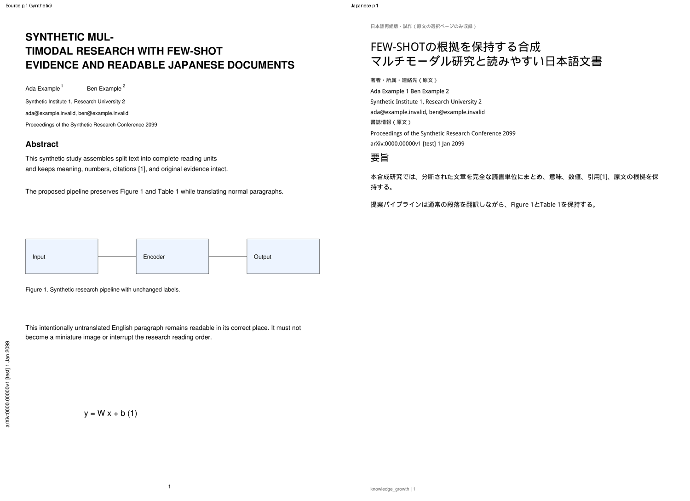
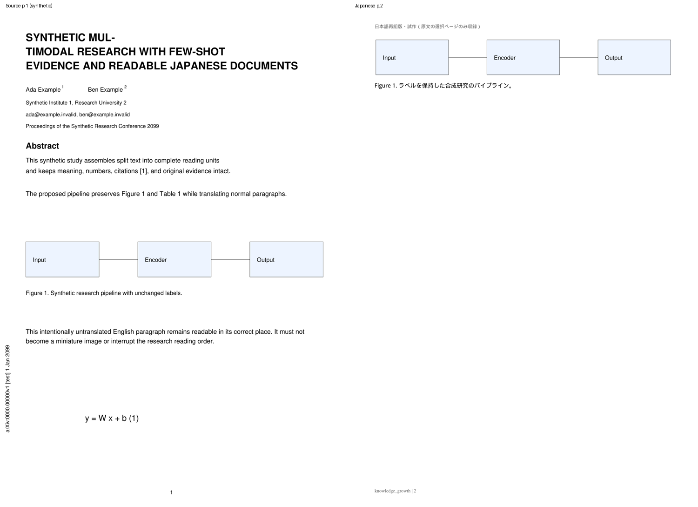
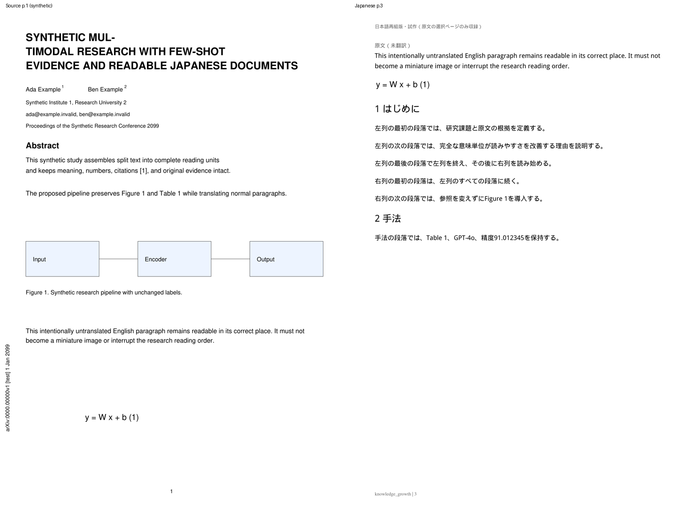
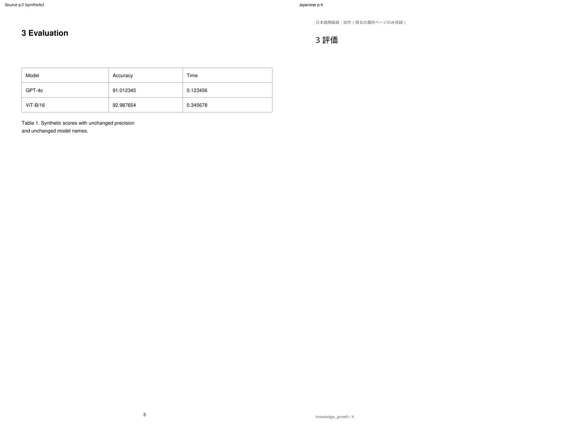
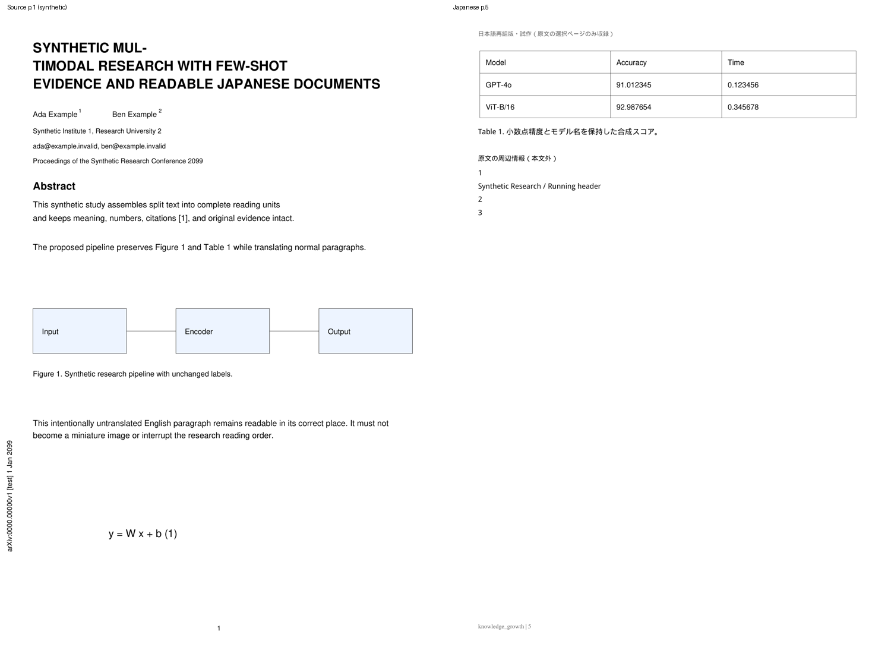
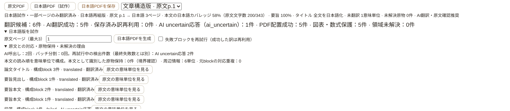

# 日本語PDFの文章構造と読書品質 — Draft PR #9

対象: T3-01 / T3-03 PoC。開始HEADは`be264bca50809d0883e980ffcbbdf49d2a1f5589`。
Windowsでは生成・保存が成功したが、タイトルの分断、Abstractの英語crop、著者や縦向きarXiv情報の混入、
繰り返しの診断注記、本文を表さない75%表示が報告された。
Cloudでは合成論文とfake runtimeのみを使用した。MMAD原本を送信していない。
**本修正後の実Windows/MMAD/実ChatGPTの品質は未検証。Draftを維持する。**

## Semantic Assembly

既存document_blocksとSourceAnchorは変更せず、コピーを意味単位へ組み立てる。
役割はpaper_title、authors、affiliations、contact、bibliographic、abstract_heading、abstract_body、
section_heading、paragraph、caption、scientific_visual、marginal_metadata、running_header、footer。

PyMuPDFのline/span、文字サイズ、位置、方向、原文blockのroleと図表保護領域を使う。
第1ページの大きな文字の連続帯からタイトルを判定し、番号付きSectionやAbstractを除外する。
タイトル候補は全構成blockを一つの単位へまとめる。構造が曖昧なら全文を原文で保持し、
部分的な日本語タイトルを確定表示しない。

通常段落は、同じ役割・列・字体規模で、未完の文が近接した行へ続く場合に結合する。
図表の内部ラベルをgutter判定から外し、左右の列の本文を左列→右列で並べる。
短い列内Section見出しを全幅の区切りと誤認しない。
Captionの隣接継続blockも同じ字体・位置を確認して一体化する。

原文spanの位置から改行を復元し、`MUL-` + `TIMODAL`、`classifi-` + `cation`等を
一般的な研究語彙に基づいて復元する。Zero-shot/Few-shot、識別子のハイフン、未知の接続は保持する。
MMADのタイトルや論文IDを特別扱いする処理はない。

翻訳promptは`prompts/japanese_pdf_v0_3.md`。組立て済みの全文とroleをAIRuntime/compatへ渡す。
roleは構造データであり、PDF本文をtrusted instructionへ昇格させない。
既存JSON/schema/ID/数値/引用/参照/専門用語検証、部分成功保存、失敗ID分離retryと時間・回数上限を維持する。
Codex app-server + ChatGPT planを使用し、API key、従量課金provider、固定モデルは追加しない。

## 保存と原文対応 — migrationなし

schema v5の既存translationsとjapanese_pdf_generations.report_jsonを再利用する。
`translations.block_id`には既存のFK制約がなく、選択範囲訳も格納できる契約である。
結合単位には`S`＋63桁のSHA-256由来IDを使う。実blockのhex IDと異なるnamespaceになる。
hashはassembly version、役割、順序付きoriginal_block_ids、組立てた原文を含む。
原文version/hash/text照合も既存契約を継続する。

単一blockで原文が変わらない場合だけ、元block IDで既存の成功訳を再利用する。
結合したタイトル・段落に古い断片訳を連結したり、全文訳として再利用したりしない。
過去の訳は削除しない。metadata/visualへ再分類した既存成功訳のrowも書き換えない。

構成blockに部分的なユーザー編集があれば、自動生成した全文訳で上書き・置換せず、
`assembled_user_edit_review`として全体を原文で保留する。既存全文groupのユーザー編集は優先して再利用する。
一般的なgroup編集UIは本PRの範囲外である。

成功・失敗reportのsemantic_unitsへ全original_block_ids、group_hash/version、role/status、translation_idと配置を残す。
互換unitsは実際の原文blockごとの行とbboxを保持し、semantic_unit_idと共通配置へ対応付ける。
日本語選択がgroupを指した場合は先頭の実blockを入口として原文へ戻る。各構成blockへもレポートから戻れる。
日本語bboxやgroup IDを原文SourceAnchorへ保存しない。Evidenceは原文PDFを正本とする。

## 読みやすい配置

layout versionは`reflow-2`、assembly versionは`semantic-1`。
原文ページ数・段組・bboxの一致は要求しない。選択した最大3原文ページ相当だけを収録する。

- タイトルは20ptの一体化した見出し。長い題名は語/CJK境界で行長を調整し、文字サイズを縮小しない。
- Abstract/Section見出し16pt、本文11pt、Caption10ptで自然に次ページへ流す。
- 通常の未翻訳文も11ptで組版し、小さなcropへ戻さない。「原文（未翻訳）」だけを小さく示す。
- 著者・所属・連絡先はタイトル下へ10ptでコンパクトにまとめ、元の名前・番号・メールを保持する。
- 学会/arXiv情報は「書誌情報（原文）」へ横書きで整理する。Running header/footer/元ページ番号は本文後の「原文の周辺情報」へまとめる。
- 情報を削除せず、metadataも文字抽出と全原文blockの対応を検証する。
- 詳細なskip理由・block ID・品質診断はReaderの折りたたみレポートに置く。
  PDF本文へ「未解決・原物保持」の診断注記を繰り返し挿入しない。

Figure/Table/Equationは原寸のnative cropで原フォント・画像・ベクターを保持する。
モデル名・小数精度・罫線・数式、Captionとの対応を維持する。
大きな原物には専用ページを使い、Captionは同じページに配置する。
厳密なnative-3検査、200dpi、pixelしきい値0.2を変更しない。
図表との境界が曖昧な本文、注釈、分離不能なCaptionは安全側の原物保持になる。
通常本文を不用意に原物とした候補数も本文カバレッジと一緒に示す。

## 品質指標

coverage.bodyは、元の研究本文の空白を除いた文字数を分母とし、配置まで成功した訳の元文字数を分子とする。
タイトル・著者/書誌情報・Section見出し・Caption・図表内部文字は本文の分母へ入れない。
図表との境界が曖昧で原物保持になった研究本文は分母へ残す。
AbstractとCaptionのカバレッジは別に測定する。

タイトルの単位数・構成block数・構造の完全性・翻訳状態、Abstractの完了状態、
本文として識別した原物保持件数、source対応の重複、文字抽出の欠落/重複、重なり、ページ外配置も評価する。
body_preserved_in_visualsは境界確認が必要な候補数であり、実論文の誤分類が確定した件数ではない。
旧成果物は従来のblock件数指標と明示し、本文カバレッジと混同しない。

本文・訳・raw AI応答は診断/通常ログへ出さない。
原文bboxのspan textと未配置時のheading_pathをreportから除き、ID・geometry・role・固定code・数値だけを残す。

## 合成fixtureの結果

3行タイトルと単語分割、著者/上付き番号、所属/メール、学会/縦向きarXiv、Abstract、
2段組Introduction、Figure/Caption、Table/複数block Caption、モデル/小数、Equationを持つ3ページを生成した。
1段落だけを意図的にuncertainとして、読みやすい英文fallbackを確認する。

| 対象 | 結果 |
|---|---|
| タイトル | 原文3block → 全文1単位、日本語見出し1つ。断片訳の混在なし |
| Abstract | 原文200文字 / 翻訳対応200文字、100% |
| 全選択本文 | 原文773文字 / 翻訳対応630文字、81.5% |
| 原文p.1だけの本文 | 原文343文字 / 翻訳対応200文字、58.3% |
| 未翻訳本文 | 143文字を11ptで一度だけ保持・原文参照あり |
| 本文の原物保持候補 | 0件 |
| Caption | 120 / 120文字、100%、図表と同じページ |
| 原物 | Figure / Table / Equationの3asset、vector保持・厳密検査成功 |
| 生成ページ | 原文3ページ相当 → 日本語5ページ |

実翻訳の品質保証ではなく、決定的なfixtureによる実装検証である。
baselineは497件成功（初回の短timeout失敗は再実行で成功）。追加14ケースを含む全511件が成功した。
一括実行では既存fake app-serverの0.4/0.5秒timeoutで認証メタデータ/URL検査が不安定になったため、
最終確認はAI Runtime **131 passed**と残り全tests **380 passed**を分けて実行した。
本番のtimeout/securityやテストのassertionは緩めていない。既存Starlette/httpx非推奨通知1件。
修正中に出た配置・原物検査の失敗は解消し、原物/clip/新semanticの62件も成功している。

browserは新semantic **11項目**、原物8、再組版17、翻訳診断8、Reader20、Import/Brief34、Structured Brief17が成功。
Phase 1のQ&A、Highlight保存/reload、PDF選択、SourceAnchor fallbackも成功。各suiteのpageerrorは0。
タイトル選択のテストはレポート開閉によるResizeObserverのsettle後に実行する。
文字/字体/原寸の厳密検査、小さな平均差の細線/画像破損、原文hash/blocksとユーザーデータ保護を維持した。

[browserの数値report](assets/japanese-pdf/semantic-browser-report.json)。
生成PDF/font binaryはGitへ追加せず、一時ディレクトリだけに保存する。

## Windows Acceptance: MMAD第1ページから

1. アプリを終了し、`git fetch origin` → `git switch feat/japanese-pdf-prototype`
   → `git pull --ff-only origin feat/japanese-pdf-prototype`。HEADをPRと照合する。
2. `start_knowledge_growth.bat`で起動し、Codex / ChatGPT planを接続する。既存v5なら追加移行なし。
3. MMADで「日本語版を試作」を開き、原文ページ`1`を指定して生成する。
   旧PDFは文章構造未検証と表示され、新生成cacheには使わない。
4. タイトルが全文の日本語見出しとして続くか、Abstractが正しい順序で日本語化されたか確認する。
5. 著者・所属・メール・学会/arXivが本文外の情報欄にあり、縦向き識別情報やfooterが本文へ割り込まないか確認する。
6. 詳細な「未解決」の注記が本文へ繰り返されないこと、未翻訳文が読みやすい原文として明示されることを確認する。
7. 本文/Abstractの文字数カバレッジ、タイトルの構成block、本文原物保持候補、skipコードを折りたたみレポートで確認する。
   古い断片訳は結合単位へ流用しないため、新しい全文翻訳が必要になる。旧成功訳/ユーザー編集は保存したまま保護する。
8. 本文の欠落/重複、図表のモデル/小数/罫線、数式、Caption、原文を見る/Evidence、選択/検索を確認する。
9. 保存して外部viewerで開き、アプリ再起動後に再表示できること、Brief/Note/Highlight/Q&Aが使えることを確認する。
10. 第1ページの読書品質が合格してから、2段組本文ページと評価表ページを検証する。

失敗時はsafe code、役割、構成block数、文字数カバレッジ、原物候補/検証件数を報告する。
MMAD PDF、本文・訳・画像、raw応答、認証情報をCloud/GitHubへ送信しない。

## 変更と残る制約

主変更: app/japanese_semantics.py、japanese_content.py、japanese_translation.py、japanese_pdf.py、
routes_japanese_pdf.py、prompts/japanese_pdf_v0_3.md、client/js/pdfalignment.js、components/japanesepdf.js。
mock providerの新prompt対応、合成fixture/tests、semantic browserと既存smokeの契約更新、API/設計記録も含む。

組立てはgeometry/字体/役割の決定的な推定であり、全論文の意味理解ではない。
複雑なタイトル/Caption、図表と交差する本文、inline数式、特殊なclip/fontは原物保持や確認対象になる。
ページ/列をまたぐ段落の完全な自動連結、OCR/VLM、全文翻訳、左右比較、group編集UIは未実装。
groupの日本語選択は原文先頭blockへのジャンプで、文単位の厳密な同期ではない。
最大3原文ページ・160元領域・64出力ページと既存AI/画像検査上限を維持する。
