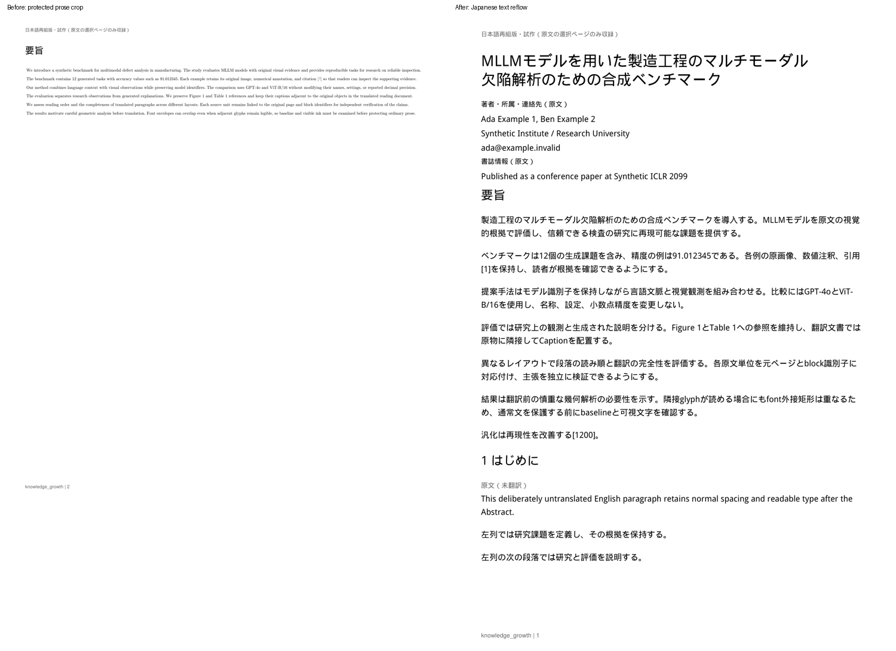
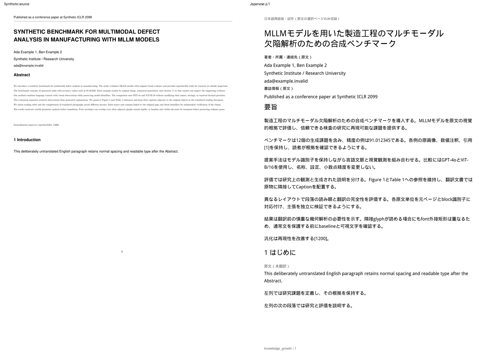

# Abstractの残存保護・原文テキスト保持の改善

Draft PR #9、T3-01 / T3-03。起点は`1a38ab9bbf8c9774856fee91fe3720d03398b123`。
MMAD原本・本文・画像・訳はCloud/GitHubへ送っていない。
**修正後の実MMAD、Windows、実ChatGPTは未検証**。以下は生成fixtureとfake runtimeによる結果である。

## 分離できた原因

Windows報告のAbstractは原文1,150文字、候補158、`ai_uncertain`158、原物保護992、配置0。
この数値だけでは992文字を保護したseedや、実際に欠落したglyphは特定できない。
タイトル89文字・要旨見出し8文字にも付いた`visual_text_changed`は、AIの個別失敗の証拠にならない。

コードと合成fixtureで、次の独立した問題を確認した。

1. `InkProof.glyphs()`は元blockの大きなfont外接矩形内へglyph中心が入るかで所属を判定していた。
   TeXのascender/descenderが広いと、別行のglyphを拾い、文字列照合失敗から特殊fontや未証明領域へ保護され得る。
   現在は**元のingest spanの文字列と矩形を原PDFのnative spanへ一意照合**し、そこに属する文字コード・originをtraceへ対応付ける。
   bbox丸めの照合許容は0.003pt、文字順は完全一致を要求する。別行を包含する大きなbboxだけでは所属を決めない。
2. `compare()`の原描画と再構築maskの完全一致は、native cropの証明には有用だが、普通の英文を文字として組み直す条件より厳しい。
   合成PDFでは正しい文字コード・fontを持つ微小な水平スケール差と、隣行のinkを含むfont外接矩形により、
   5組が`overlap_unproven`となり、通常英文1,106文字がnative原物へまとめられた。
   実際に文字が衝突したという意味ではない。元の診断は消さず、独立した本文復元証明を追加した。
3. `cropped_visual()`はclip外の隠れた文字を消すため、使い捨てcopyへtext-only redactionを行う。
   **clip境界にまたがる文字のbboxが外側redactionに触れると、その文字全体を削除する**。
   120×14ptの合成cropでは、元block38文字、clip抽出22文字、境界glyph1件、redaction後21文字、crop21文字、配置21文字、
   trace glyph24→23となった。欠落1・混入0、`crop_text_complete=false` / `source_text_preserved=false` / `glyph_codes_preserved=false`で拒否する。
   従来`crop_no_hidden_text`も全文一致を測るためfalseになり、混入だけを意味する`unexpected_text`が付いていた。
   合否条件は保ったまま、欠落／混入／順序差を数値から分類するようにした。
4. `routes_japanese_pdf.py`の例外処理は、全体のPDF品質エラーをpending/translatedの全単位へ書き戻していた。
   成功済みタイトルや見出しまで翻訳失敗に見え、DBのstatus/reasonも汚していた。
   PDF公開失敗で成功訳・cache・ユーザー編集rowを書き換えず、段階別状態をreportへ記録する。

[境界cropの安全な数値結果](assets/japanese-pdf/recovery-crop-report.json)。
これは実MMADで同じ文字が欠落したという主張ではない。

## 通常本文と科学的原物の契約

通常英文を復元できた場合は、Semantic Assemblyの通常textとして翻訳する。
AIが`uncertain`等を返した場合も**11ptの選択・検索できる英文**として組み直す。
小さなnative cropを通常本文の標準fallbackには使わない。

新しい復元経路はAbstract専用でもMMAD専用でもない。paragraph / abstract_bodyに対し、以下を全て要求する。

- 複数の英文語から通常文章と判断できる。
- 元文字列と原PDFのglyph所属・順序が一致し、Unicode→glyph ID、埋め込みfont program、advance、horizontal/opaque fillを検証できる。
- font programの各glyph outlineを元origin/sizeへ配置し、0.25ptを外側へ加えた保守的な矩形でも、別段落のoutlineやpositive scientific seedと交差しない。
- 利用可能な288dpi mask同士のink交差が0。mask不能・glyph不明・文字衝突ならこの経路を採用しない。
- 可視範囲を証明できないclip/groupを使わない。clipがある場合は単一矩形で全glyph outlineを包含する必要がある。
- drawing / image / detected_table / numeric_table / equation / special-font seedと本文の境界証明を従来どおり実行する。
  本物の図表や必須保護範囲を切り捨てない。境界が未解決なら公開を拒否する。

復元できたpairだけ計画上のtext-only cropを作らず、`prose_recovery`へ元ID、分類、glyph数、文字数を記録する。
元の`pairs` / `overlap_unproven`は残す。pairごとの文字数は重複があるため、カバレッジへ加算しない。
カバレッジは意味単位に含まれる元blockの文字数から一度だけ計算する。

**Figure/Table/Equationのnative-3合否条件・0.2 pixelしきい値は変更していない。**
原資源のvector/font/glyph/path/image、細線、数値精度、clip、200dpi表示の検査は維持する。
科学的な配置を持つ領域、実衝突、不明なglyphは原物保持し、crop自体が完全でなければ公開しない。
通常本文だと証明できないものを無条件でAIへ渡さない。

## 段階別診断と保存

各意味単位と元blockのreportに次を分けて保存・表示する。

| 項目 | 意味 |
|---|---|
| ai_translation_state / error | AI成功、未成功、対象外／未完了と個別の安全なコード |
| placement_state | 未配置、render済み、配置検証済み、原物配置失敗 |
| visual_quality_state / error | 該当assetのみpassed/failed、本文はnot_applicable |
| publication_state | 最終PDFの公開状態 |

例えばTableの細線を壊した合成ケースは公開failedになるが、タイトルはAI succeeded / placement validated / visual not_applicableとなる。
Table以外のFigure/Equation検査はpassedのまま。成功訳はretryで再利用し、故意に編集済みにしたrowも失敗時はtimestamp/status/reasonを含めて不変だった。
`PDF配置成功`は公開済みの訳の件数を維持し、別に全種類の意味単位（metadata・原物を含む）の`配置検証済み`件数と`PDF公開`を表示する。
Abstractの配置文字数は局所検証済みの数を示すため、別assetが失敗した場合にも保持する。公開失敗ならファイル取得は404のまま。

原物ごとに`original_block_chars`、原文clip文字数、境界glyph数、redaction後・crop・crop全抽出・配置後の
expected/actual/missing/extra文字数、順序一致、glyphコード一致、`text_failure_stage`を記録する。
本文、訳、raw応答、glyphコードそのもの、fontデータ、画像、認証情報は記録しない。
`crop_no_hidden_text`は既存の厳密な全文照合フラグのまま。falseだけで「余分な文字あり」と断定せず、追加のmissing/extra件数を見る。

**追加migrationなし、schema v5**。translationsとjobのreport_jsonを再利用する。
layoutを`reflow-6`へ上げ、古い生成物を削除せず、新生成cacheとは区別する。
既存document_blocks / SourceAnchorは不変。original_block_ids / group hash / 原文へのジャンプを維持する。
span復元で全文が変われば新しいgroup hashを使い、古い部分訳を誤適用しない。元の成功訳・ユーザー編集は残す。
Codex app-server + ChatGPT plan、APIキー不要、bounded retry、タイトル意味reviewは維持する。

## 合成結果・比較画像

旧HEAD全体を別ディレクトリへ`git archive`で展開し、同一の生成PDF・fake runtimeを実APIへ登録した。
1,150文字・7分割Abstract、TeX風の広いfont bbox、上付き引用・数値・モデル名、ヘッダー罫線、Introduction、独立Figure/Table/Equationを含む。
旧HEADは原物cropのまま公開できるケースであり、**技術的に生成成功でもAbstractの読書品質を満たさない**状態を再現した。

| Abstract・原文文字数換算 | 旧HEAD | 修正後・正常AI fixture | 修正後・全Abstract uncertain |
|---|---:|---:|---:|
| 原文 | 1,150 | 1,150 | 1,150 |
| 翻訳候補 | 44 | 1,150 | 1,150 |
| 原物保護 | 1,106 | 0 | 0 |
| 日本語化 | 44 | 1,150 | 0 |
| PDF配置 | 1,150 | 1,150 | 1,150 |
| うち日本語配置 | 44 | 1,150 | 0 |

Windowsの158 / 992をそのまま再現した数値ではない。一般的な失敗条件を合成で再現・修正している。
正常fixtureでは本文1,467文字中1,371文字を日本語化（93.46%）、Caption56/56、タイトル全文を日本語化した。
全1,150文字の訳は順番どおり1回ずつ抽出でき、元IDの欠落・重複・用紙外・文字重なり0。
Figure/Table/Equationの3assetはベクター、font/glyph/path/image一致、平均pixel差0でnative-3を通過した。
意図的なTable細線破損は1assetだけ特定して公開拒否し、既存の小差分破損検出も維持する。





[日本語2ページ](assets/japanese-pdf/recovery-comparison-2.png) / [FigureとCaption](assets/japanese-pdf/recovery-comparison-3.png) /
[TableとCaption](assets/japanese-pdf/recovery-comparison-4.png) / [Equation・本文外の書誌情報](assets/japanese-pdf/recovery-comparison-5.png) /
[段階別の失敗表示](assets/japanese-pdf/recovery-stage-failure.png)。全5ページを200dpiでrenderし目視確認した。
未翻訳fixtureも11ptの英文として確認した。図表専用ページと、その前後の短い本文ページには大きな余白が残る。
今回の修正はAbstract復元であり、高度な図表の詰合せは実装していない。

[旧HEAD数値](assets/japanese-pdf/recovery-before-report.json) /
[修正後browser・品質数値](assets/japanese-pdf/recovery-browser-report.json)。生成PDF/font binary/runtime DBはGitへ入れていない。

## 検証コマンド

```bash
python -m pytest tests/ -q
python scripts/smoke_japanese_recovery_browser.py --chromium /usr/bin/chromium --output /tmp/kg-recovery-browser
```

baselineは566 passed、最終版は**576 passed（追加10件、288.86秒）**、既存Starlette/httpx非推奨通知1件。
追加テストは本文復元、隣行中心の誤所属、実衝突/図形交差/clipの拒否、境界redaction欠落、
見えない余分な文字の拒否、公開失敗時のAI/cache/編集保護、ローカル診断のreadonlyを含む。
Chromiumは**159項目成功、pageerror 0**。新規recovery7、既存reflow17 / reading10 / semantic11 / overlap6 / boundary7 / translation8 / visual10 / Reader20 / Import・Brief34 / Structured Brief17 / runtime12。
visualの旧エンジン比較は旧detectorも合わせて読み込むようharnessを修正し、当時の候補8/成功6/保護26を再現した。
Phase 1のQ&A / Highlight保存・reload / PDF選択 / SourceAnchor fallbackも別途成功。
[全browser件数・Phase 1結果](assets/japanese-pdf/recovery-regression-report.json)。
58件の本文復元・native/clip品質テストも成功し、細線・小差分画像・表の小数精度・glyph/font/clip・Captionの破損拒否を維持した。

## WindowsでMMAD p.1を確認

1. アプリ終了後、既存branchを更新する。作業中の変更がある場合は先に保存する。

   ```powershell
   git fetch origin
   git switch feat/japanese-pdf-prototype
   git pull --ff-only origin feat/japanese-pdf-prototype
   git rev-parse HEAD
   ```

2. `start_knowledge_growth.bat`で起動し、ChatGPT planへ接続する。
   MMADを開き、「日本語版を試作」で原文ページ`1`を指定する。
   「失敗ブロックを再試行」を選んで生成する。既存の全文一致する成功訳は再利用する。
   履歴で**本文再組版改善版**を選ぶ。過去の失敗や保護cropの履歴と区別する。
3. 折りたたみreportでAbstractの原文1,150、翻訳候補、原物保護、日本語化、PDF配置を確認する。
   目標は通常本文の候補1,150 / 原物保護0。AIがuncertainなら候補と訳の成功は別であり、11pt英文で表示される。
   候補が戻ったことだけで日本語化完了とは判断しない。
4. タイトル・要旨見出しのAI状態と、PDF配置・原物検査・公開状態を別々に見る。
   失敗assetの元ページ、元block/clip文字数、redaction/crop/配置の欠落・混入数、glyph一致と発生段階を確認する。
   全体失敗だけを根拠にタイトルの翻訳失敗と判断しない。
5. 成功時はAbstractの全段落順、単語間space、数値・引用・モデル名、11pt英文fallback、欠け/重複を確認する。
   日本語から「原文を見る」とPaper BriefのEvidence、検索・文字選択、保存・外部viewer、再起動復元を確認する。
6. まだ候補不足や原物検査失敗があれば、アプリと同じKG_DATA_DIRで、以下をローカル実行する。
   source IDはURL `/#/read/<source_id>` で確認できる。

   ```powershell
   .venv\Scripts\python.exe scripts\diagnose_japanese_overlap.py --source-id "<source_id>" --pages 1 --inspect-crops
   ```

   DBは`mode=ro`、AI・ネットワーク・DB更新・PDF/画像ファイル出力なし。使い捨てcropはメモリ内で閉じる。
   `pages[].text_units`のrole/文字数/glyph proof error/native span所属、`prose_recovery`、seed/contact/boundary、
   `crop_diagnostics`の欠落段階を数値で確認できる。
   原文・訳・PDF・スクリーンショット・raw応答・認証情報をCloud/GitHubへ送らない。
7. p.1の読書品質に合格してから、2段組本文・評価表ページへ進む。merge判断はWindows確認後に行う。

## 変更範囲と制約

- app: japanese_content / japanese_extraction / japanese_overlap / japanese_visual_quality / japanese_pdf /
  japanese_semantics / japanese_translation / routes_japanese_pdf。
- client: `js/components/japanesepdf.js`。既存single-controller/Reader/SourceAnchorを変更しない。
- scripts: readonly診断、既存reflow smokeのversion期待値、visual比較harness、新しいrecovery browser。
- tests: recovery factory・受入テスト、既存version/関数signature期待値、readonly検査の自動analysis競合を抑えるfixture設定。
- docs: 本記録・README・prototypeからの参照、生成画像と数値report。

未知font、非水平glyph、非矩形clip、実際の文字衝突・科学的原物との接触など、復元を証明できない領域は残る。
native cropに文字欠落があれば引き続き公開しない。全文翻訳、OCR/VLM、完全同期、図表内部翻訳は範囲外。
日本語fontは従来のDroid Sans Fallback（Apache 2.0）を使う。フォントの新規再配布はない。
**合成での改善を実MMAD成功と扱わず、Windows再検証を必要とする。**
