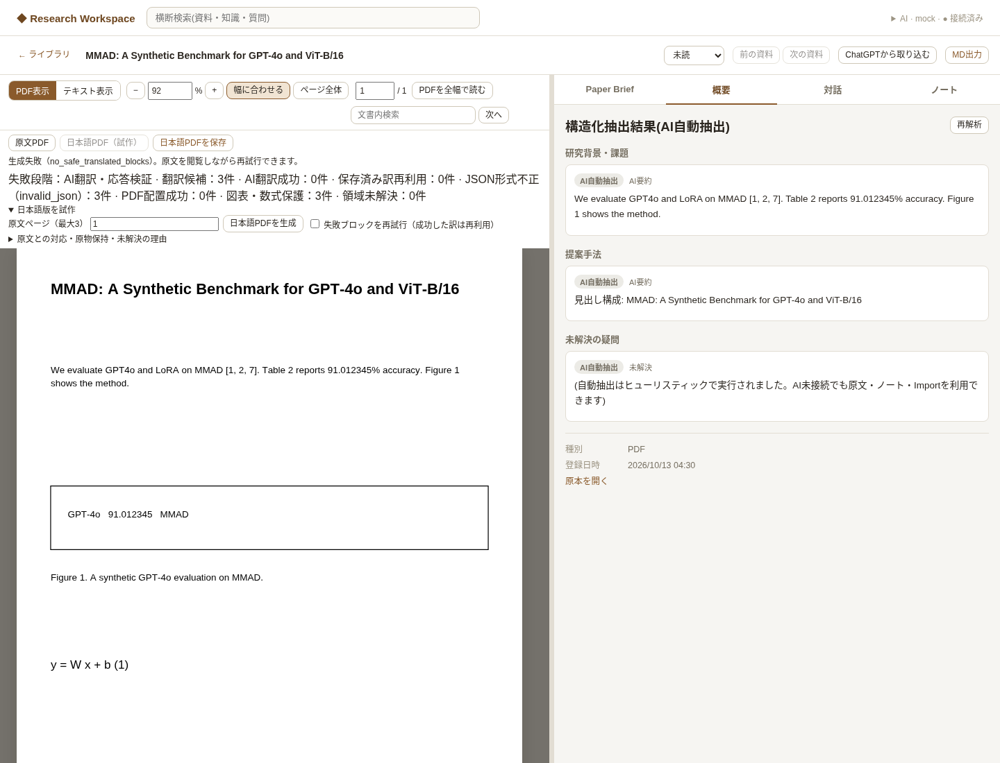
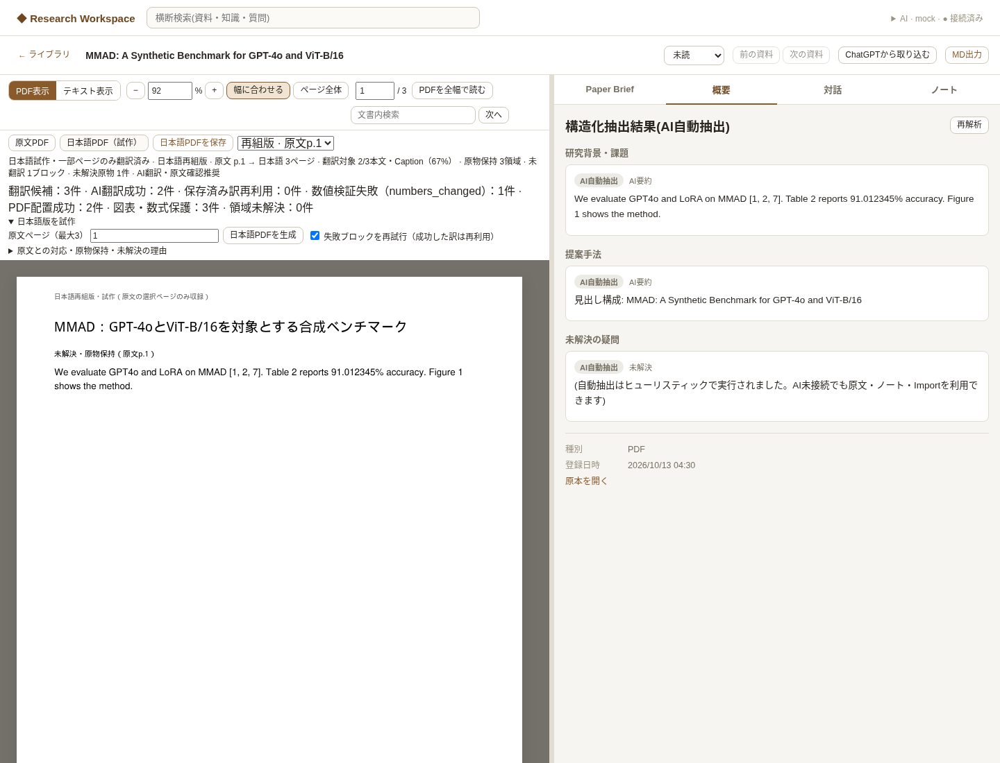

# 日本語PDF翻訳の部分成功・失敗診断 — Draft PR #9追加修正

更新: 2026-10-13。T3-01 / T3-03の再組版試作への追加修正。
WindowsでMMAD原文p.1を実ChatGPTで生成した結果、候補3件がすべて
`failed / translation_failed`、`no_safe_translated_blocks`になったとの報告を受けた。
本修正後のWindows/MMAD/実ChatGPT応答はまだ検証していない。
CloudにはMMADを送らず、合成PDF・fake AIRuntime・fake app-serverを使用した。

## 確認した原因

旧`validate_reply()`はID・schema・数値・日本語をバッチ全体について検証し、
1件でも失敗すると正常なブロックも保存しなかった。
`translate_units()`はJSON/ValidationError/LLMError等を同じexceptで無視し、
最終的に全件を`translation_failed`にしていた。
RuntimeProviderもAIErrorをLLMErrorの文字列へ変換しており、型付きの原因コードが失われていた。

このため正常な訳も巻き込まれ、翻訳失敗とPDF配置失敗の判別ができなかった。
**実機で最初に起きたAI応答/RPCの具体的原因は、旧記録から確定できない。**
以下の分類を追加して、再試行で確認できるようにした。

## 失敗分類と安全性

| safe code | 意味 |
|---|---|
| ai_runtime_error / ai_rpc_error | Runtime・認証状態等 / RPC拒否・接続・protocol |
| ai_timeout / ai_incomplete_turn / ai_cancelled | 待ち時間超過 / completedなし / 中断 |
| invalid_json | JSON不正、重複キー、非有限数、説明文の混入 |
| schema_mismatch | envelopeまたは対象IDの要素schemaが不一致 |
| block_id_mismatch | 欠落、重複、架空・不明ID |
| numbers_changed | 数値・精度・符号・指数・%の不一致 |
| citations_changed / references_changed | 引用番号の順序・構成 / 図表・数式の参照先 |
| terms_changed | 保護対象のモデル・専門識別子の欠落・変更 |
| japanese_required / ai_uncertain | 日本語未生成 / AIが不確実と回答 |
| translation_validation_error / output_too_large | その他検証 / 応答サイズ上限 |
| translation_attempt_limit / translation_time_limit | 未試行の単位に適用する回数・時間上限 |

AIのraw response、Pydanticのエラー本文、PDF本文、翻訳文、認証情報をログや診断reportへ出さない。
例外メッセージを解析せず、型付きRuntimeコードを固定コードへ分類する。
未知のRuntimeコードも固定`ai_runtime_error`へ落とす。
本文と訳は従来どおりTranslationUnitと生成PDFにのみ保存する。
診断reportはコード・件数・段階・試行回数等の数値だけを追加する。

## バッチ分離と再試行

1. 最大8block / 6000文字で入力を分ける。最大24初期batch。
2. JSON全体とenvelopeを確認し、期待IDごとにschema・日本語・数値等を独立検証する。
3. 正常な訳を既存`translations`へ即commitする。失敗・uncertain・欠落IDだけを次の試行へ渡す。
4. 同じサイズで最大2回試した後、未解決が複数なら二分してqueueへ戻す。必要なら単一blockになるまで分ける。
5. すべての初期batch・分割・再試行で、**合計48 Runtime呼出し / 単位最大8試行 / 全体600秒**を共有する。
   1回の待ち時間は120秒か残りjob時間の短い方。Codexのsession/RPC/turn待機へ同じdeadlineを渡す。
   中断RPCは2秒まで、その後は既存の有限process終了処理を使う。終了処理の猶予は翻訳待ち時間とは別。
6. 上限で止めても、既に保存した成功は失わない。最後の具体的失敗コードを保持し、
   `stopped_by`で上限停止を別途記録する。未試行なら上限コードを設定する。

架空IDの行は採用・保存しない。重複したIDはそのIDを拒否する。
対応が明確な正常IDの訳は保持できる。架空ID混入は試行診断にも記録する。
途中で成功した訳は同じsource/version/block/原文/hashなら次の生成で再利用する。
失敗した本文は原物表示で残し、成功した本文・Captionは再組版する。
Captionが失敗した場合も英語Captionを対応図表の近くに保持する。

## JSON互換性・数値保護

新promptは`prompts/japanese_pdf_v0_2.md`。
blockごとの独立翻訳、exact ID、uncertainだけ空文字、原語識別子、数値・引用・参照の維持を明示する。
Codex agentMessageの複数deltaを結合し、completedを必須にする。
厳密なJSONか、**全応答が1つの完全なJSONコードフェンス**である場合だけを受け付ける。
説明文からJSON部分を探したり、不正JSONを修復したりしない。schema検証は両方に適用する。
モデル固定・API key・従量課金providerを追加していない。既存security isolationを維持する。

旧数値正規表現は小数・バージョン・引用の数字のCounterを比較していた。
符号や指数の符号を区別できず、参照番号の入れ替えも同じCounterなら通り得た。
新検証は桁数・精度・符号・科学記法・%を維持し、引用の構成/順序とFigure/Table/Equationの対応も確認する。
引用の空白や数値と%の間の空白は意味を変えないので許可する。
数値の追加・削除・丸め、負号/指数変更、引用の入れ替えは拒否する。

合成MMAD風タイトル、GPT-4o / GPT4o / ViT-B/16 / LoRA / MMAD、引用[1, 2, 7]、
Table 2 / Figure 1、91.012345%、-0.50、1.2e-3、桁区切り1,024で正常訳と改変を確認した。
日本語の助詞に接する英語識別子も検出する。
一般語のstate-of-the-artやmulti-modalを日本語化しても誤って専門識別子変更と判定しない。
全文の意味・任意の固有名詞を自動保証するものではなく、実訳の意味は原文と照合する必要がある。

## 保存・UI・回帰契約

既存TranslationUnitのstatus/reasonへ固定コードを保存する。
失敗した旧rowを成功させた場合は同じrowを再利用し、実際に使ったprompt versionを更新する。
ユーザー編集済みの訳・provider/model/promptの来歴は自動上書きしない。
追加テーブル・migrationはない。schema v5と既存reportを維持する。

成功・失敗の両reportへ`diagnostics`を追加する。

| field | 意味 |
|---|---|
| translation_candidates | 検出された翻訳対象数。原物内blockは含めない |
| translation_succeeded | 新AI訳と保存済み訳を合わせた翻訳成功数 |
| ai_translation_succeeded / cached_translations | 今回新しく成功 / 保存済み訳を再利用 |
| translation_failures | 最終的な失敗コード別の単位件数 |
| pdf_placement_succeeded | 完成PDFへ配置・検証・保存できた日本語単位数。未公開なら0 |
| protected_units / unsafe_units | 原物保持単位数 / 曖昧で保留した単位数 |
| failure_stage | 原文確認・候補検出・翻訳・PDF配置/品質・保存のどこで失敗したか |
| runtime_calls / split_batches / elapsed_seconds | 実行回数・分割・時間 |
| attempt_errors / stopped_by | 再試行中の検出件数と上限停止。最終失敗数と別 |

旧reportにdiagnosticsがなくても表示できる。
再組版本文11pt、自然な改ページ、原物とCaption、SourceAnchor・対応jump、保存と再起動復元を維持した。

## 検証結果

baseline **390 passed**。追加修正後の全pytestは**449 passed**（既存Starlette/httpx非推奨通知1件）。
新しい翻訳・診断・deadline関連を追加した。実ChatGPTログインは要求しない。
正常訳、分割delta/fence、JSON/重複キー/schema、欠落/架空/重複ID、数値/引用/参照/モデル変更、
日本語未生成、uncertain、Runtime/RPC/timeout/incomplete/cancelled、partial success、
call/unit/time上限、成功cache、旧row/prompt来歴、配置失敗との区別、再起動を確認した。
subprocess fake app-serverでは既定RPC/turn timeoutが20秒でも0.15秒のdeadlineで終了・中断できる。

ブラウザは新診断**8項目**、既存再組版17、Reader20、Import/Brief34、Structured Brief17、AI接続12項目成功。
Phase 1の原文選択/Highlight保存・reload/Q&A/Anchor fallbackも成功。pageerrorはいずれも0件。
合成PDFのpartial successは**候補3 / AI成功2 / 数値不一致1 / PDF配置2**。
原物保持3単位（図のownerと内部文字、数式）。図自体と数式の原物は2件。
再試行はAI呼出し1回で未解決1件を翻訳し、保存済み2件を再利用した。
元PDF不変、生成PDFの文字抽出、原物保持、保存/reloadも確認した。




[診断browser report](assets/japanese-pdf/translation-browser-report.json)。画像を目視してコード・件数が読めることを確認した。
再現コマンド:

```bash
.venv/bin/python -m pytest tests/ -q
.venv/bin/python scripts/smoke_japanese_translation_browser.py
.venv/bin/python scripts/smoke_japanese_pdf_browser.py
```

## Windows / MMAD p.1の再試行

1. アプリを終了し、repositoryで`git fetch origin` → `git switch feat/japanese-pdf-prototype`
   → `git pull --ff-only origin feat/japanese-pdf-prototype`。`git rev-parse HEAD`でPR headと一致することを確認する。
2. `start_knowledge_growth.bat`で起動する。schema v5なら追加migrationはない。
3. 右上のAI表示でCodex / ChatGPT planが接続済みか確認する。
   timeout/RPC後にエラー状態なら「再接続」を押す。必要ならChatGPTで認証し、「最小接続テスト」を実行する。
4. MMADを開き、Readerの「日本語版を試作」で**原文ページ1**を指定する。
   「失敗ブロックを再試行（成功した訳は再利用）」をチェックし、「日本語PDFを生成」を押す。
5. 翻訳候補、今回のAI成功、保存済み訳再利用、コード別の最終失敗、PDF配置、原物保持を確認する。
   `no_safe_translated_blocks`でも「失敗段階」が翻訳かPDF配置/品質かを確認できる。
   旧履歴の`translation_failed`は遡って分類できないので、**今回の生成結果**を見る。
6. 部分成功でも日本語PDFを表示できる。未翻訳箇所と理由、本文11pt、読み順、図表・数式・Captionを原文と照合する。
   「原文を見る」とBrief Evidence、検索/選択、download、再起動後の再表示を確認する。
7. 失敗が残った場合は、**診断コード・件数・失敗段階**を記録する。
   PDF本文・翻訳文・raw AI応答・認証情報・MMAD PDFをCloud/GitHubへ送らない。

実Windowsでこの修正が成功したとは主張しない。Windowsの再試行結果と品質でmergeを判断し、Draftを維持する。

## 主な変更ファイル

- `app/japanese_translation.py`: unit検証・分離retry・数値/識別子保護・安全診断・prompt来歴。
- `app/ai/base.py`, `compat.py`, `codex.py`, `process.py`: 型付きadapter error・deadlineと中断。
- `app/routes_japanese_pdf.py`: 成功/失敗のdiagnosticsと段階、既存report保存。
- `client/js/components/japanesepdf.js`: 分類コードと件数、翻訳/配置の区別。
- `prompts/japanese_pdf_v0_2.md`, `app/llm/mock.py`: 明示的JSON契約と合成mock互換。
- `tests/test_japanese_translation.py`, `test_ai_runtime.py`, `test_japanese_pdf.py`,
  `tests/fixtures/`: fake turn/subprocess/PDFの検証。
- `scripts/smoke_japanese_translation_browser.py`: 失敗/partial/retry UI・保存確認。
- 本書、試作設計/API/README、診断画像・browser report。
