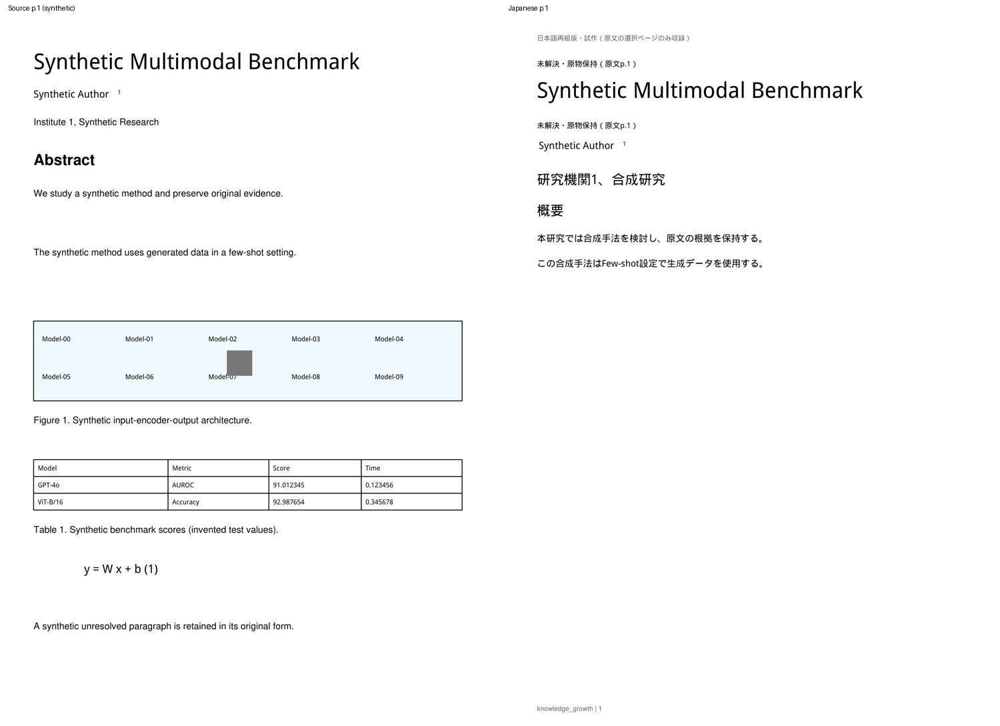
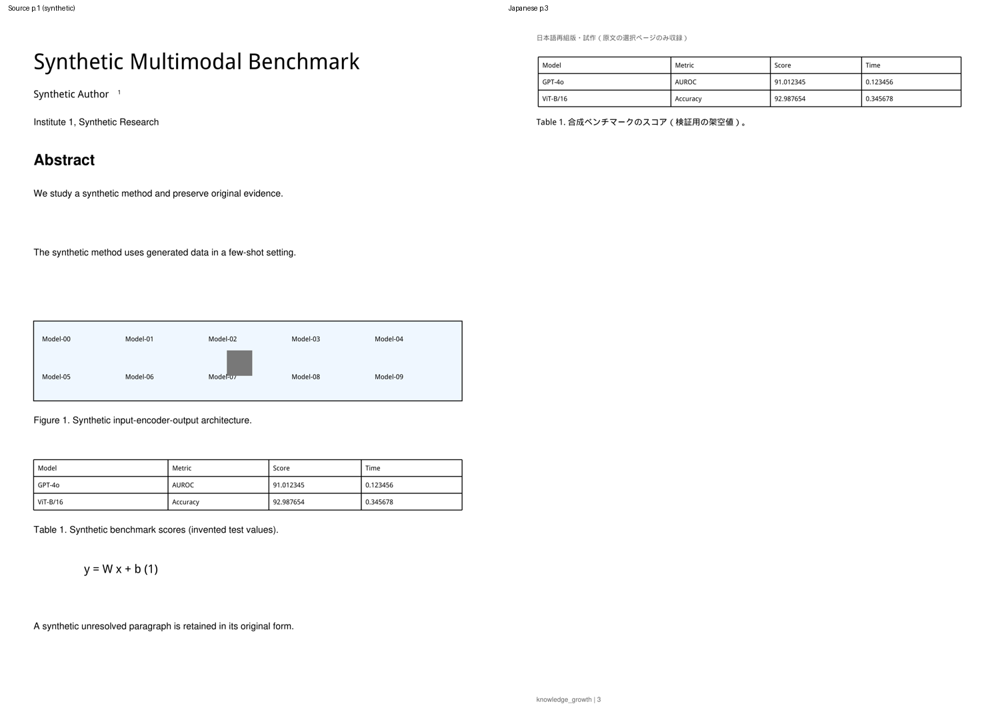
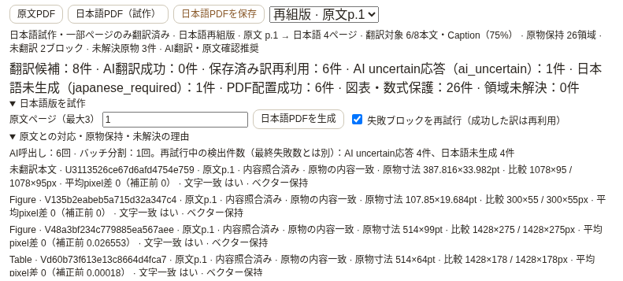

# 日本語再組版PDFの原物検証 — Draft PR #9追加修正

最新の`native-3`では、original_textの不可視Form命令を別に検証する。
[pixel差0のclip構造不一致への追加修正](japanese_clip_quality.md)を参照。
以下はnative-2導入時の原因・検証記録。

更新: 2026-10-13。T3-01 / T3-03 PoC。追加migrationなし、schema v5 / reflow-1を維持。
WindowsのMMAD原文p.1で、候補8・AI成功6・ai_uncertain1・japanese_required1・保護26、
PDF品質検証で`visual_content_changed`という結果が報告された。
**この追加修正後のWindows/MMAD/実ChatGPTは未検証。MMAD原本はCloudへ送っていない。**

## 確認した原因と修正前後

旧検査はFigure/Table/Equationだけでなく`original_text` fallbackも同じ200dpi平均pixel差で評価し、
最初の差>0.2で例外を返して検査情報を失っていた。このコードから「図表が破損した」とは断定できない。

埋め込みTrueTypeフォントの大きな英語タイトルで再現した。
旧DisplayList → DocumentWriterはPDFの文字描画命令を再生成し、文字のadvance/位置に差が生じた。
合成タイトルの文字内容・glyph数は同じでも、再配置後の通常renderの平均差は**8.002617**になった。
このタイトルではglyph originの最大差が0.519998pt、共通原点renderでも平均差6.328073だった。
それとは別に、ページ上の小数座標・CropBox・rotation・clipのpixel切り上げによる位相差も起こり得る。

旧HEAD `9e1993ef9efa0e3b2e8af3f637ad89d56eebe3a3`のエンジンをテストサーバーで実行し、
**AIが6件成功した後にoriginal_textのvisual_content_changedで失敗**することを確認した。
これは合成PDFの原因であり、Windows MMADの具体的な原因は新しいasset診断で確認する必要がある。

| 合成fixture | 旧エンジン | 修正後 |
|---|---|---|
| 候補 / AI成功 / 未翻訳 | 8 / 6 / 2 | 8 / 6 / 2 |
| 原物保持単位 | 26 | 26 |
| 大きなタイトルの通常render平均差 | 8.002617、失敗 | 0.0 |
| 未翻訳本文 | 失敗原因の種類不明 | 2領域を原文のまま保持、文字/clip/外観を照合 |
| PDF公開 | 失敗、file取得404 | 日本語4ページ、6翻訳単位を配置 |
| 原物検査 | 最初の1件で中断 | 6assetを個別検証・記録、全件成功 |
| 人為的に線を追加した4原物 | — | Figure2 / Table1 / Equation1を全件検出、公開拒否 |
| 再試行 | 成功訳は既存基盤へ保存 | 6件を再利用、未解決2件だけAIへ渡す |

## 原フォント・ベクターを保つ切り出し

`cropped_visual()`を`app/japanese_visual_quality.py`へ分離した。
DocumentWriter経由の再生成を廃止し、**元ページの使い捨てコピーから原フォント・画像・ベクター資源をコピーする**。
原本のbytes・ファイルは変更しない。

clipだけではPDF.jsが領域外の非表示文字を抽出するため、使い捨てコピーのclip外文字だけを除去する。
`fill=False / images=0 / graphics=0 / text=0`を明示する。
白色矩形を描かず、画像・線・ベクターを削除しない。
切り出し後の通常抽出とINFINITE_RECT抽出を原文clipの文字列と比較し、欠落と隠れた隣接本文を確認する。
境界に交差した文字が除去されるなど、安全な切り出しを証明できない場合は成功扱いしない。

既存の曖昧なgeometry/Caption/注釈のページ保持を維持する。
元ページを保持する場合は、そのページの全unitを原物groupへ移し、同じ内容の日本語段落を重ねない。
切り出し後の品質不一致に対しては、図表を強引に画像へ置換して成功扱いする救済を追加していない。
失敗時も原文PDFを閲覧でき、成功した6件等の訳は保存して再試行で使える。

## 判定方式

共通のlocal pixel原点で標準DisplayList.get_pixmapを使って200dpi renderする。
通常のページ座標renderも残し、補正前/後の差と比較サイズを診断へ記録する。
pixelの丸めで-1や余分な端pixelが生じた場合も、同じlocal座標の固定比較frameへコピーする。
空画像同士を誤って比較しないよう、実際のink pixel数を記録し、公開Page renderとの一致もテストする。

**平均差0.2は変更していない。** 文字一致だけでpixel差を無視しない。
原寸、文字、glyph、フォント資源、線・図形、画像、外観がすべて一致して初めて通す。
小数座標のserializationに限り、形状/文字位置には0.02ptの比較精度を使う。
色・opacityは1000倍して比較し、色差への同じ許容幅を適用しない。

| 検証対象 | 判定 |
|---|---|
| original_text | 原文clipとの文字一致、glyph数/ID/位置/属性、clip全域と非表示文字の欠落・混入、原寸、外観 |
| Figure/Table/Equation | 上記に加え、線・曲線・塗り・stroke・画像pixel内容/寸法/配置を原物と比較。Captionは同じページの対応group |
| 数字・モデル・数式 | 原文文字列とglyph IDの一致。原フォントprogramも照合し、別glyphや別フォントへの置換を検出 |
| 細い水平/垂直線 | zero-area bboxもstroke幅で含める。平均差が0.2未満でも線の欠落を拒否 |
| 画像 | pixel digestをメモリ内で照合。平均差が小さい1階調の改変も拒否。digestはreportへ出さない |
| 描画位相 | 補正前だけ差が大きく、共通原点renderとすべての内容照合が一致した場合だけraster_alignmentとして通す |
| 検査できないフォント等 | visual_font_validation_unavailable / validation_unavailableとして拒否。Type3はこのPoCの資源検証対象外 |

glyphの文字/ID不一致と位置・描画属性不一致を分け、後者には最大origin差を数値で記録する。
フォントのPostScript名とprogram内のfamily名の違いも解決して比較する。
文字・フォント・path・画像の実データを保存/ログへ出さず、照合結果だけを保持する。

## 注釈の画像化

元のベクター文字を一度だけ保持し、注釈付きページの原表示を200dpiで重ねる。
PNG encode/decodeのpixel一致と、生成PDFへ入った実際の画像digestを確認する。
pixelを小数pointのbboxへ縮めず、1 source pixel = 1 validation pixelで置く。
元のbase文字/線/画像と注釈表示を分けて検査する。
FreeText注釈も外観として保持し、元の文字列を重複した非表示text layerへ追加しない。

report/UIで**vector_preserved=false / 画像化（200dpi・内容照合済み）**を明示する。
注釈の文字は派生PDF内で検索/選択できない場合があり、200dpiより大きな拡大では画像の限界がある。
原文PDFは保持しているので正本へ戻って確認できる。

## 失敗時のsafe report

`VisualQualityError`に安全な`quality.visuals[]`だけを付ける。
生成PDF全体の公開は止めるが、最初の1件で中断せず、検査できる全assetの結果を収集する。
切り出し自体が失敗した場合も、そのassetのkind/page/サイズとcrop_unavailableを残す。

記録する情報:

- asset_id / asset_kind（original_text / figure / table / equation）、原文/日本語ページ。
- 原物/配置サイズpt、CropBoxサイズ、原文rotation、DPI。
- 通常/共通原点の比較画像サイズと平均pixel差、ink pixel数。
- 文字一致、glyph数/ID一致、最大位置差、フォント/線/画像照合、clip欠落・混入の有無。
- vector保持、注釈画像化/検証状態、passed/failed、固定error/classification。
- 全失敗数/成功数、diagnostics.visual_failuresのkind別件数。

本文、訳、font名・program、glyph値、画像、digest、raw AI response、認証情報、local pathは含めない。
失敗時もAI成功数とtranslation_failuresを維持し、ai_uncertain/japanese_requiredをPDF品質失敗とは別に示す。
Readerの理由欄にassetごとの寸法・差分・文字一致・vector状態を表示する。

reportに`visual_quality_version=native-2`を追加する。schema v5のreport_jsonを再利用し、migrationは追加しない。
旧成果物は削除せず表示/download可能だが、新基準で未検証と表示し、新生成の完成cacheへ返さない。
原文に対応する保存済み訳は新生成でも再利用する。

## 自動検証と目視

baseline **449 passed** → 最終pytest **480 passed**（既存Starlette/httpx非推奨通知1件）。
原物関連を31件追加。合成PDFだけを使用し、実ChatGPTログインは不要。

大きな埋め込みfontの英語タイトル、著者名/所属番号/上付き、Abstract、通常本文、
Figureの10ラベル＋画像、Tableのモデル/小数/罫線、Equation、8候補/6訳/2fallback/保護26を検証した。
CropBox、0/90/180/270 rotation、小数clip、Font名alias、隠れた隣接文字、不要な文字、clipサイズ改変、
glyph削除/別font、細い線の欠落、画像の改変、white cover、FreeText/矩形注釈、1pixel注釈画像改変を検証した。
空の出力rasterに対して内容のある原物が失敗することも確認した。

原PDF bytes/hash、Note/Highlight/Briefのrowが失敗前後で不変であり、壊れた派生PDFを公開しない。
成功訳6件のcache、2 IDのみのretry、download、再起動復元を確認した。

新原物browser **9項目**、翻訳診断8、既存再組版17、Reader20、Import/Brief34、Structured Brief17項目成功。
Phase 1の原文選択、Highlight保存/reload、Q&A、Anchor fallbackも成功。pageerrorは0件。







画像を目視し、Title/著者/上付き/モデル/小数/線/数式の保持、本文11pt、Caption隣接、
未翻訳部分が一度だけ収録されることを確認した。
比較画像の原文p.1と日本語p.1〜4は独立したページ番号で、同番号の意味対応ではない。
[before/after/人為的破損/retryのbrowser report](assets/japanese-pdf/visual-browser-report.json)。

再現コマンド:

```bash
.venv/bin/python -m pytest tests/ -q
.venv/bin/python scripts/smoke_japanese_visual_browser.py --baseline-ref 9e1993ef9efa0e3b2e8af3f637ad89d56eebe3a3
.venv/bin/python scripts/smoke_japanese_pdf_browser.py
```

出力PDF/画像はOS一時directoryのkg-visual-browser。生成PDFやfont binaryはGitへcommitしない。

## Windows / MMAD p.1

1. アプリを終了する。repositoryで`git fetch origin` → `git switch feat/japanese-pdf-prototype`
   → `git pull --ff-only origin feat/japanese-pdf-prototype`。`git rev-parse HEAD`をPRの最新headと照合する。
2. `start_knowledge_growth.bat`で起動。schema v5なら追加移行なし。
3. 右上でCodex / ChatGPT planの接続済みを確認。エラーなら「再接続」、必要ならChatGPT認証を行う。
4. MMAD Readerの「日本語版を試作」で**原文ページ1**を指定。
   「失敗ブロックを再試行（成功した訳は再利用）」をチェックし、「日本語PDFを生成」。
5. 保存済みの6件を再利用できるか、未解決2件だけが再試行されるか確認する。
   ai_uncertain/japanese_requiredが残っても、その領域の原文保持とPDF品質は別に判断する。
6. 「原文との対応・原物保持・未解決の理由」を開き、今回のasset kind、原文ページ、
   2つの比較サイズ/平均差、文字一致、ベクター/画像化、分類を確認する。
   旧失敗記録は遡って分類できないので、新しい生成結果を見る。
7. 日本語本文、未翻訳タイトル/段落、著者/上付き、モデル/小数/罫線/数式、Captionを原文と照合。
   「原文を見る」・Brief Evidence・検索/選択・保存・外部viewer・アプリ再起動も確認する。
8. 失敗が残れば、**safe code / asset kind / 原文ページ / 寸法 / pixel差 / 文字一致 / vector状態**を記録する。
   原文・訳・画像・MMAD PDF・raw AI response・認証情報はCloud/GitHubへ送らない。

実WindowsでMMADが成功したとは主張しない。Draftを維持し、実機の再試行結果と品質でmergeを判断する。

## 変更ファイルと残る制約

- `app/japanese_visual_quality.py`: 原資源crop、共通原点render、内容照合、safe diagnostics。
- `app/japanese_pdf.py`: 検証group、全asset収集、annotationの検証済み画像化、public report。
- `app/routes_japanese_pdf.py`: failed quality report・kind別件数、新品質versionのcache契約。
- `client/js/components/japanesepdf.js`: asset診断と旧基準/画像化の明示。
- `tests/test_japanese_visual_quality.py`, `tests/fixtures/japanese_visual_factory.py`: 再現と改変検出。
- `scripts/smoke_japanese_visual_browser.py`: 旧HEAD/new/破損/retry/注釈UIの実行と比較画像。
- 本書、試作設計/API/README、比較画像と数値report。

最大3原文ページ、160領域、24初期batch/48 Runtime呼出し/600秒、64出力ページ、
1原物の検査1,600万pixelまで。複雑なclip、欠落geometry、未検証font等は失敗/原物保持のままになる。
Type3の資源照合、OCR/VLM、図表内部翻訳、全論文翻訳、左右比較、完全な文単位同期は未実装。
Cloudでの合成fixture検証をMMADの品質保証とは扱わない。
