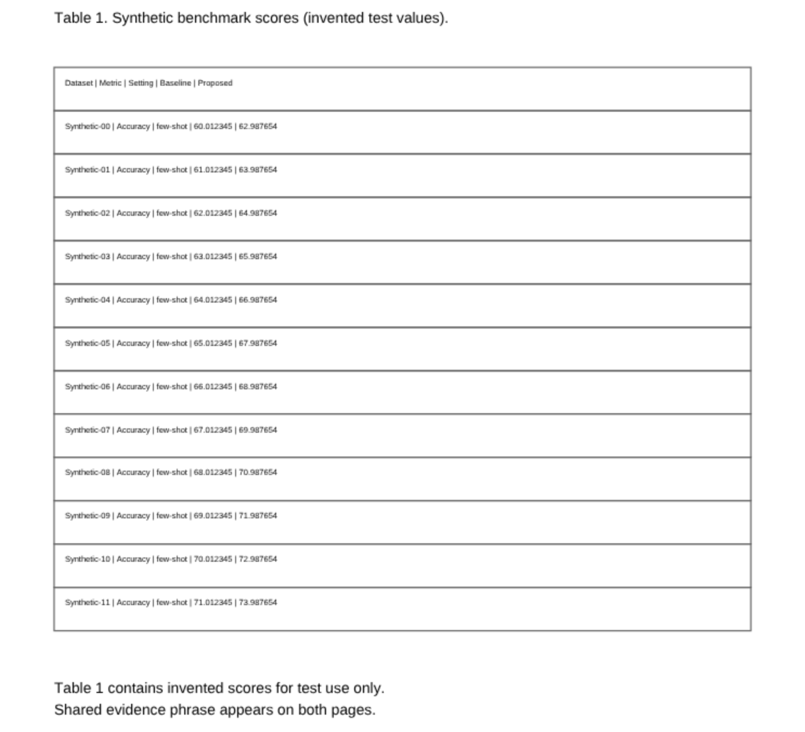
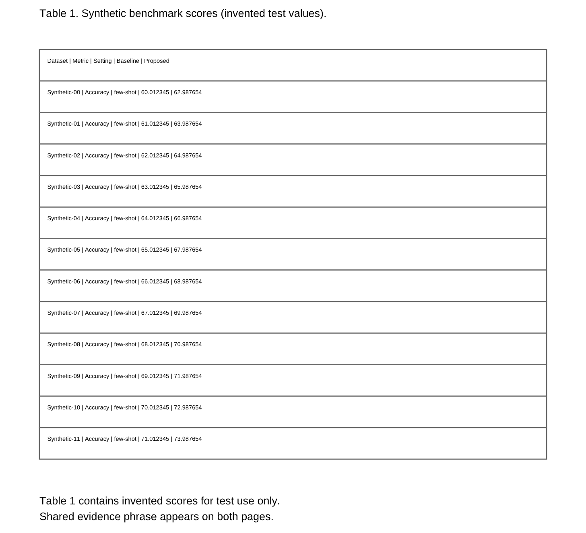
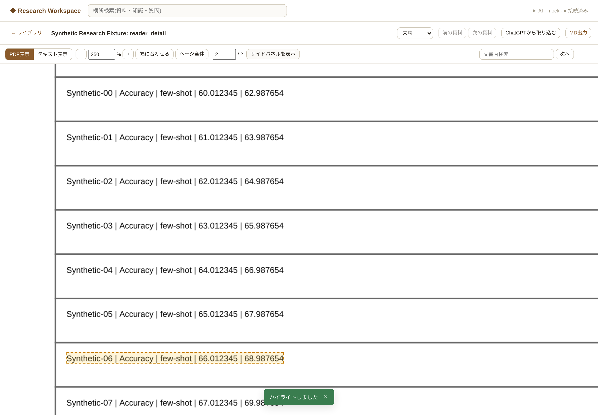
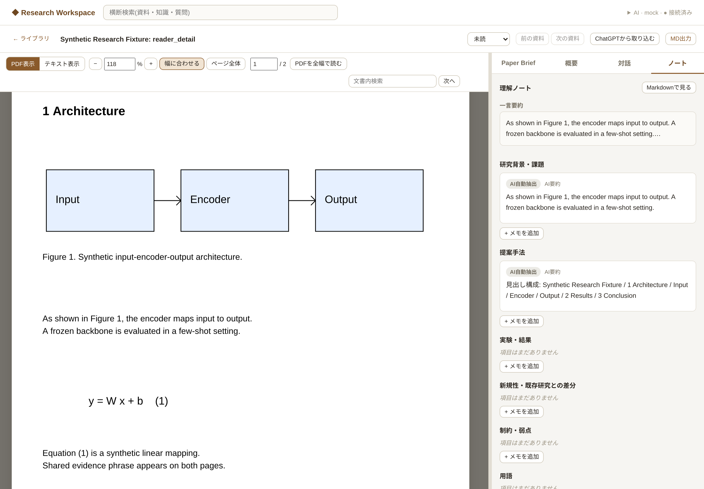

# 原文PDF Readerの高DPI・ズーム・全幅表示

更新: 2026-10-13。対象: T3-04、T10-03の原文PDF状態復元部分。
基点: `0321390`（PR #7のWindows hotfixを含むmain）。

## 変更内容

`client/js/components/pdfviewer.js`でCSS viewportとcanvas内部pixel数を分離した。
100%はPDF pointを96/72 CSS pixelへ変換した表示。手動倍率は75〜250%。
幅に合わせる／ページ全体では各ページの回転後寸法から倍率を計算するため、
75%未満になる場合がある。ページ全体では現在ページを中央に置き、全体を表示する。
倍率変更ごとにPDF.jsで再描画し、既存canvasのCSS拡大だけでは済ませない。

内部倍率はdevicePixelRatioに従い、1ページ600万pixel・各辺8192pixelで制限する。
600万pixelのRGBA rasterは約24MB。保持は描画中を含めて最大5ページ、
page canvas合計の理論上限は約120MB。PDF.jsのworker、元PDF、font、画像decode、
GPUやブラウザの管理領域を含むプロセス全体のメモリ上限ではない。
大きなページ、高倍率、高DPIでは内部倍率を下げる。

TextLayerにはCSS viewportの倍率変数と回転変換を適用する。
SelectionはCSS座標からPDF.jsで逆変換し、Evidence markerはsource bboxから順変換する。
DPRをSourceAnchorへ混ぜない。Phase 1の未回転・CropBox左上原点・point単位、
`pymupdf_unrotated`契約は変更しない。DB migrationは不要。

Readerには倍率入力、拡大／縮小、fit width／fit page、ページ番号入力、
右側パネル開閉を追加した。パネルのDOMは維持するため、選択タブとパネル内の
scroll位置・入力内容を維持する。dividerの幅変更とwindow resizeに追従する。

`kg.reader.<sourceId>`に`pdfView: {mode, zoom, position: {page,x,y}}`、
`sidePanelCollapsed`、既存の`activeTab`／`paneWidthPct`、`blockScrollTop`を保存する。
x/yは閲覧領域の中心が指すページ内の相対位置。ズーム・幅変更時はこの位置を復元し、
scroll・pagehide・Reader破棄時に保存する。PDF／テキスト表示の位置は別々に保持する。
旧`scrollTop`は初回の互換fallbackとして読む。localStorageが使えなくても閲覧は続けられる。
先頭・末尾やページ間の余白ではscroll範囲内に丸めるため完全には一致しない。

## 描画と競合の扱い

全ページの寸法を先に読み、軽量なページ枠を保持する。
表示中のページを優先し、直前・直後ページまでを必要に応じて描画する。
遠いページのcanvasとTextLayerは解放するが、枠とviewportは残す。
未描画の60ページ目にもbboxで移動し、その後描画できる。
現在のDOM選択があるページは同じ5ページ枠内で保持する。

render queueは1本。page generationとlayout revisionで遅い結果を拒否し、
キャンセルのsettle後にcanvasをゼロ寸法へ戻してpage cleanupを実行する。
TextLayerもcancelし、PDFを隠すとrastersを解放、Reader破棄時にloading task／worker、
ResizeObserver、scroll／resize listenerを破棄する。
Evidenceのsource geometryは再配置に使い、新しいEvidence navigationでは旧状態を消す。

## 検証

生成fixtureのみを使用。`reader_detail`は6ptの表と小数6桁の数字、
Figure／Caption、数式を持つ2ページPDF。`long_reader`は60ページで、
ページ幅の違いと10ページごとの90度回転を含む。元の6 fixtureの内容は維持した。

- main baseline: pytest **326 passed**。準備済みvenvに不足していたjsonschemaを導入して再確認。
- 最終pytest: **330 passed**。既存のStarlette/httpx非推奨通知1件。
- Phase 1 browser: 右列PDF選択、回転＋CropBox、Highlight保存・reload、Q&A、bbox／quote fallback、候補／page-only。
- Paper Brief／Import browser: **34項目成功**。
- Structured Brief generation browser: **17項目成功**。
- 新Reader browser: **21項目成功**。DPR1/2/3/8、内部解像度上限、倍率入力、
  再描画、ズーム後の6pt表選択、Evidence枠と候補の破線表示の再配置、ページジャンプ、全幅、タブ、
  divider resize、reload、PDF／テキスト表示切替、60ページでのevictionと再描画、
  90／180／270度回転、300ms遅延completionを加えた描画中の連続操作と画面遷移。
  各browser suiteのpageerrorは0件。

DPR2・表示幅728pxでcanvasは1456×2060pixel（CSSは728×約1030px）。
mainでは約728×1030pixelだった。250%ではCSS約1983×2807pxに対しcanvas約2059×2913pixelで
600万pixel以内に抑えている。測定値は[ブラウザレポート](assets/reader/browser-report.json)。

同じ生成表をDPR2で撮影し、本文・captionと数字の輪郭を目視確認した。

| main・幅に合わせる | 改善後・幅に合わせる |
|---|---|
|  |  |





再現（各browser scriptはPlaywright／Chromiumを使う開発用opt-inテスト）:

```bash
.venv/bin/python -m pytest tests/ -q
.venv/bin/python -m pip install playwright
.venv/bin/python scripts/smoke_reader_browser.py --chromium /usr/bin/chromium
.venv/bin/python scripts/smoke_import_brief_browser.py --chromium /usr/bin/chromium
.venv/bin/python scripts/smoke_brief_generation_browser.py --chromium /usr/bin/chromium
```

新Reader／Import／Briefのbrowser scriptは一時dataディレクトリのmock serverを自動起動し、
終了時に削除する。Phase 1 browserだけは既存の手順どおり別terminalでmock serverを起動する。
`--baseline-url`でmainを別ポートに起動すると、改善前の画像も生成できる。
スクリーンショットとレポートの既定出力先はOSの一時ディレクトリ。実論文PDFは同梱しない。

## Windowsでの確認

1. このbranchを取得し`start_knowledge_growth.bat`で起動。AI未接続のままPDFを閲覧できる。
2. PowerShellから`.venv\Scripts\python.exe scripts\generate_pdf_fixtures.py`を実行。
   `tests\fixtures\generated\reader_detail.pdf`と`long_reader.pdf`を登録する。
3. Edge／ChromeでWindows表示scaleを125%／150%／200%に設定し、幅に合わせる、
   75%／100%／175%／250%、倍率の直接入力、ページ全体を確認。
   6ptの表の小数値、Figure／Caption、数式が読み取れることを確かめる。
4. 表を選択してハイライト保存。テキスト表示から原文へ戻り、Evidence枠を確認。
   回転ページでも選択と枠が文字に一致することを確認する。
5. 中ほどの段落で全幅／パネル再表示、divider移動、ブラウザreloadを行う。
   選択タブ、倍率、開閉状態、ページ内位置が復元されることを確認する。
6. long_readerの30／60ページへ移動し、連続ズーム中にライブラリへ戻って別PDFを開く。
   古いページが混入しないことを確認する。DevToolsで`.pdf-page canvas`が5個以下、
   `width * height`が600万以下、canvas CSS寸法と内部寸法が分離していることを確認する。
7. 自動確認は`.venv\Scripts\python.exe -m pytest tests/ -q`。
   Browserテストは`.venv\Scripts\python.exe -m pip install playwright`、
   `.venv\Scripts\python.exe -m playwright install chromium`の後、
   `$env:KG_AI_RUNTIME="mock"`として`smoke_reader_browser.py`等を実行する。

## 制約と次段階

実Windows・実論文・非Chromiumブラウザは未検証。DPIはChromium contextで模擬した。
スキャン画像の元の解像度、OCR、文字抽出の品質はこの変更では改善しない。
数千ページ規模では最初の寸法取得とshell DOMがページ数に比例する。
テストで確認したのは60ページの描画管理で、ブラウザ全体のpeak RSS測定ではない。
PDF.jsのcanvas renderer、annotation／form未対応、複数ページにまたがる選択から
単一Anchorを作らない既存制約は継続する。

表示controllerはfileUrlと表示状態を受け取るが、英語／日本語の同時controller、
ページ対応や意味位置のalignmentは未実装。次PRではT3-01／T3-03を基礎に
図表・数式を保持した日本語PDFを試作し、T3-06でSourceAnchorを言語間対応へつなぐ。
原PDF、AI Runtimeと認証処理は変更していない。
